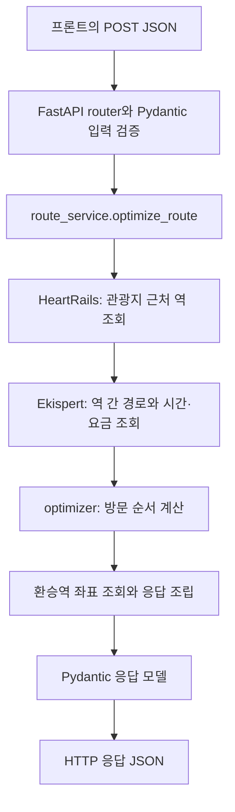

# 여행 동선·주변 관광지 추천 백엔드

일차별 관광지 목록으로 방문 순서·예상 도착 시각·교통비를 계산하고, 역 목록에서 추천 거점을 골라 주변 관광지를 검색하는 FastAPI 서버다.

| API | 역할 |
| --- | --- |
| `POST /api/routes/optimize` | 관광지 방문 순서 최적화와 역·환승역 좌표 조회 |
| `POST /api/nearby/recommend` | LLM으로 앵커 역을 선택하고 해당 역 주변 관광지 추천 |

## 서버 실행 — 첫 번째 터미널

저장소 루트에서 시작한다. Python 3.12 이상과 Poetry를 사용한다.

```bash
cd backend
poetry install
xvfb-run -a poetry run uvicorn app.main:app --host 0.0.0.0 --port 8000
```

`Uvicorn running on http://0.0.0.0:8000`이 나오면 서버가 준비된 것이다. 이 터미널은 켜둔다.

이 크롤러는 Xvfb 안에서 `headless=False`인 Playwright Chromium을 실행한다. 실행 환경에 `xvfb-run`과 Playwright Chromium이 준비되어 있어야 한다. Chromium을 아직 설치하지 않았다면 `poetry run playwright install chromium`으로 설치한다.

서버가 실행되면 다음 주소를 사용한다.

| 주소 | 용도 |
| --- | --- |
| `http://localhost:8000/docs` | Swagger UI. 입력·출력 모델을 확인하고 요청을 보내는 화면 |
| `http://localhost:8000/openapi.json` | API 구조와 모델을 담은 OpenAPI JSON |
| `http://localhost:8000/api/routes/optimize` | 동선 최적화 요청 주소. HTTP `POST`로 호출 |
| `http://localhost:8000/api/nearby/recommend` | 역 주변 관광지 추천 주소. HTTP `POST`로 호출 |

Codespaces에서는 8000번 포트를 전달한 주소 뒤에 `/docs`를 붙이면 된다. 동선 최적화에는 Google·Gemini API 키가 필요하지 않다. 관광지의 Google Place ID는 프론트가 검색 결과에서 얻어 전달한다.

주변 관광지 추천만 호출한다면 브라우저를 실행하지 않으므로 Xvfb 없이 아래처럼 서버를 켤 수 있다. 두 API를 함께 사용할 때는 위의 Xvfb 실행 명령을 사용한다.

```bash
cd backend
poetry run uvicorn app.main:app --host 0.0.0.0 --port 8000
```

### 주변 관광지 추천용 API 키

주변 관광지 추천은 Google Places와 Gemini를 사용한다. 저장소 루트의 `.env`에 다음 값을 설정한 뒤 서버를 시작한다. 앱은 시작 시 이 파일을 읽으며, 이미 설정된 환경 변수는 덮어쓰지 않는다.

```dotenv
GOOGLE_PLACE_API_KEY=발급받은_Google_Places_API_키
GEMINI_API_KEY=발급받은_Gemini_API_키
GEMINI_MODEL=gemini-3.5-flash-lite
```

`GEMINI_MODEL`은 선택 설정이며 생략해도 위 모델을 사용한다. API 키는 서버에서만 관리하고 프론트의 요청 JSON에는 넣지 않는다. 키가 없어도 서버와 동선 최적화 API는 사용할 수 있으며, 주변 관광지 추천 요청에는 `503`을 반환한다.

## 동선 최적화 curl 테스트 — 두 번째 터미널

`POST /api/routes/optimize`에 JSON 본문을 보낸다. 서버는 입력을 검증하고 외부 조회·최적화를 마친 뒤 결과 JSON을 HTTP 응답으로 돌려준다. 크롤링이 길어지면 응답을 받기까지 시간이 걸린다.

새 터미널을 열고 저장소 루트에서 아래 명령 전체를 복사해 실행한다. 요청 JSON이 명령 안에 있으므로 별도 테스트 파일이 필요 없다.

아래 `test-sensoji`, `test-tokyo-skytree`는 **curl 호출 확인용 임시 ID**다. 현재 서버는 Place ID를 필수 문자열로 검증하고 결과에 보존하며, 실제 Google ID인지 조회하지 않는다. 동선은 위도·경도로 계산하므로 이 예제도 실제 역·경로 조회를 수행한다. 프론트 연결 시에는 검색 결과의 실제 Google Place ID를 보낸다.

```bash
cd backend

curl -sS -X POST http://localhost:8000/api/routes/optimize \
  -H 'Content-Type: application/json' \
  --data-binary @- <<'JSON' | poetry run python -m json.tool --no-ensure-ascii
{
  "startDate": "2026-11-10",
  "dayCount": 1,
  "days": [
    {
      "dayIndex": 1,
      "dailyStartTime": "08:00",
      "places": [
        {
          "name": "센소지",
          "googlePlaceId": "test-sensoji",
          "location": {"lat": 35.7148, "lng": 139.7967}
        },
        {
          "name": "도쿄 스카이트리",
          "googlePlaceId": "test-tokyo-skytree",
          "location": {"lat": 35.7101, "lng": 139.8107}
        }
      ]
    }
  ]
}
JSON
```

결과 JSON은 두 번째 터미널에 출력되고, 서버·크롤링 로그는 첫 번째 터미널에서 확인한다. `--no-ensure-ascii`는 결과의 한글·일본어를 그대로 표시한다. 서버를 종료할 때는 첫 번째 터미널에서 `Ctrl+C`를 누른다.

이 요청은 관광지 2개이므로 성공하면 `days[0].visits`에 관광지 2개, `days[0].legs`에 이동 구간 1개가 들어간다. 방문 순서는 알고리즘이 정하며 역 좌표의 `lat`·`lng`는 모두 값이 있어야 한다. 이동 시간과 교통비는 실행 시 실제 조회한 결과에 따라 달라진다.

### 입력

| 필드 | 의미 |
| --- | --- |
| `startDate` | 여행 시작 날짜. `YYYY-MM-DD` |
| `dayCount` | 여행 일수. 1 이상의 정수 |
| `days` | 일차별 일정. 개수는 `dayCount`와 동일 |
| `days[].dayIndex` | `1`부터 `dayCount`까지 중복·누락 없는 일차 |
| `days[].dailyStartTime` | 일본 현지 시작 시각. `HH:mm`, 생략하면 `08:00` |
| `days[].places` | 하루 관광지 1~8개. 입력 순서는 최적 방문 순서가 아님 |
| `places[].name` | 관광지 이름. 최소 1글자 |
| `places[].googlePlaceId` | **필수** 관광지 Google Place ID. 빈 문자열이나 공백만 있는 값 불가 |
| `places[].location.lat` | 위도. -90~90 |
| `places[].location.lng` | 경도. -180~180 |

관광지 Google Place ID는 최적화 후에도 해당 관광지와 함께 보존된다. 역 정보에는 Google Place ID를 넣지 않는다.

### 출력

| 필드 | 의미 |
| --- | --- |
| `days[].visits` | 최적 방문 순서대로 정렬한 관광지. 이름·좌표·Google Place ID와 예상 도착 시각 포함 |
| `days[].legs` | 연속한 관광지 사이의 이동 구간. 관광지 n개이면 n-1개 |
| `legs[].route` | 해당 구간에서 이용하는 역과 노선의 순서 |
| `legs[].durationMinutes` | 구간 전체 소요 시간. 단위는 분 |
| `legs[].fare` | 구간 전체 교통비. 단위는 엔 |
| `days[].totalTravelMinutes`, `totalTransportFare` | 일차별 이동 시간·교통비 합계 |
| `totalTravelMinutes`, `totalTransportFare` | 여행 전체 이동 시간·교통비 합계 |

관광지 좌표와 역 좌표는 구분한다. 환승역까지 포함해 역 좌표를 조회하며, 좌표를 확보하지 못하면 오류로 중단한다. 응답 일시는 RFC 3339 형식이며 시간대는 `Asia/Tokyo`, 통화는 `JPY`다. 전체 필드와 스키마는 `/docs`에서 확인할 수 있다.

## 주변 관광지 추천 curl 테스트

서버를 켠 상태에서 저장소 루트의 새 터미널에 아래 명령을 실행한다. 입력 JSON을 명령에 포함하므로 별도 파일이 필요 없다.

```bash
cd backend

curl -sS -X POST http://localhost:8000/api/nearby/recommend \
  -H 'Content-Type: application/json' \
  --data-binary @- <<'JSON' | poetry run python -m json.tool --no-ensure-ascii
{
  "travelTypes": ["culture", "nature"],
  "userRequest": "사찰이나 공원처럼 조용히 둘러볼 수 있는 곳을 추천해줘.",
  "stations": [
    {
      "stationId": "station-1",
      "name": "浅草",
      "line": "都営浅草線特急・三崎口行",
      "location": {"lat": 35.711883, "lng": 139.798214}
    },
    {
      "stationId": "station-2",
      "name": "新橋",
      "line": "ゆりかもめ・豊洲行",
      "location": {"lat": 35.666195, "lng": 139.758587}
    }
  ],
  "placeCount": 3,
  "radius": 1000,
  "maxAnchorCount": 2
}
JSON
```

이 예제는 최대 두 역을 선택할 수 있도록 허용한다. LLM이 한 역만 선택할 수도 있으므로 `results`의 길이는 1 또는 2다. 선택된 역마다 최대 세 관광지를 반환하며, 검색 결과가 부족하면 그보다 적거나 0개일 수 있다.

요청 진행 상황은 서버를 켠 터미널의 `INFO` 로그에서 확인한다. 앵커 역 선택, 역·태그별 주변 검색, 후보 정리와 추천 완료 건수·소요 시간이 표시되며, 실패하면 오류 로그가 남는다. 로그 설정을 바꾼 뒤에는 서버를 재시작한다.

### 입력

| 필드 | 타입·조건 | 의미 |
| --- | --- | --- |
| `travelTypes` | string 배열, 1개 이상 | `culture`, `nature`, `anime`, `shopping`, `relaxation`, `activity` 중 선택. 복수 선택 가능하며 중복은 제거 |
| `userRequest` | string, 기본값 `""` | 앵커 역 선택 시 LLM에 전달할 사용자 요청사항 |
| `stations` | 역 배열, 1개 이상 | 추천 거점으로 선택할 후보 역 목록 |
| `stations[].stationId` | string 또는 null, 선택 | 프론트에서 관리하는 역 ID. 응답에 그대로 반환 |
| `stations[].name` | string 또는 null, 선택 | 역 이름 |
| `stations[].line` | string 또는 null, 선택 | 노선·행선지 원문. LLM의 역 선택에 사용하며 출력에는 포함하지 않음 |
| `stations[].location.lat` | number, -90~90 | 역 위도 |
| `stations[].location.lng` | number, -180~180 | 역 경도 |
| `placeCount` | integer, 1~20 | 선택된 역 하나당 반환할 관광지 최대 개수 N |
| `radius` | number, 0 초과~50,000 이하 | 역 중심 검색 반경. 단위는 미터 |
| `maxAnchorCount` | integer, 1 이상 또는 null, 선택 | LLM이 선택할 역 개수의 상한. 생략 또는 null이면 `max(1, 역 개수 // 2)`, 지정한 값이 역 개수를 넘으면 역 개수로 제한 |

### 출력

| 필드 | 의미 |
| --- | --- |
| `results` | 선택된 역별 추천 결과 배열 |
| `results[].station` | 선택한 입력 역의 `stationId`, `name`, `location`. `line`은 제외 |
| `results[].radius` | 요청한 검색 반경. 단위는 미터 |
| `results[].requestedCount` | 역 하나당 요청한 최대 관광지 개수 |
| `results[].returnedCount` | 실제 반환한 관광지 개수 |
| `results[].recommendedPlaces` | 지도에 표시할 주변 관광지 배열 |
| `recommendedPlaces[].googlePlaceId` | Google Places의 장소 ID. 동선 최적화의 관광지 입력에도 사용 가능 |
| `recommendedPlaces[].name` | 장소 이름 |
| `recommendedPlaces[].location` | 관광지의 `lat`, `lng` |
| `recommendedPlaces[].address` | 주소. 제공되지 않으면 null |
| `recommendedPlaces[].primaryType` | Google의 대표 장소 유형. 제공되지 않으면 null |
| `recommendedPlaces[].searchTags` | 이 장소를 검색해 얻은 여행 태그 목록. 장소가 여러 검색에 등장하면 태그를 합침 |
| `recommendedPlaces[].distanceMeters` | 선택된 역과 관광지 사이 직선거리. 단위는 미터이며 도보 거리·시간과 다름 |

프론트는 `results[].station.stationId`로 입력 역과 결과를 연결하고 `recommendedPlaces[].location`으로 지도 마커를 표시할 수 있다. 추천 장소를 여행 일정에 추가할 때는 `name`, `location`, `googlePlaceId`를 동선 최적화 API에 전달한다.

### 추천 흐름과 현재 범위

1. 사용자 요청사항·여행 태그·역 목록을 기존 Gemini 래퍼에 보내 앵커 역을 선택한다. LLM은 후보 ID 목록만 반환하며 서버가 실제 입력 역에 연결한다. 없는 역 ID·중복 선택·개수 초과는 오류로 처리한다.
2. 선택된 역마다 기존 Google Nearby Search 클라이언트로 주변 장소를 조회한다. 태그가 하나면 최대 N개, 복수면 태그 전체에 검색 개수 `2 × N`을 나누어 요청한다.
3. 같은 역에서 얻은 장소는 Google Place ID로 중복을 제거하고, 좌표가 없거나 반경 밖인 장소는 제외한다.
4. 태그가 하나면 검색 결과의 거리순을 유지해 최대 N개를 반환한다. 복수 태그면 후보 중 최대 N개를 랜덤 선택한다. 결과가 부족해도 개수를 채우기 위한 추가 검색은 하지 않는다.

앵커 선택에만 LLM을 사용한다. `select_recommendations()`의 LLM 순위 선정은 TODO로 남겨두었으며, 현재는 사용자 자유 문장을 관광지 순위에 반영하지 않는다. 서로 다른 역의 추천에는 같은 장소가 포함될 수 있다.

## 코드 구조와 요청 흐름

```text
app/
├── main.py                    # FastAPI app 생성, 환경 설정, router 연결
├── api/
│   ├── routes.py              # POST /api/routes/optimize
│   └── nearby.py              # POST /api/nearby/recommend
├── schemas/
│   ├── route.py               # 동선 최적화 요청·응답 모델
│   └── nearby.py              # 주변 추천 요청·응답 모델
├── services/
│   ├── route_service.py       # 역 조회·경로 수집·최적화·응답 조립
│   └── nearby_service.py      # 앵커 역 선택·주변 검색·추천 결과 조립
├── clients/                   # Google Places·HeartRails 외부 API 호출
├── llm/                       # 기존 Gemini·GPT 호출 래퍼
├── crawling/                  # Ekispert 경로 크롤링
└── optimizer/                 # 이동 시간·요금을 이용한 방문 순서 최적화
```



- **Uvicorn**은 HTTP 요청을 받는 서버 프로그램이다. `app.main:app`은 `app/main.py`의 `app` 객체를 실행한다는 뜻이다.
- **API 라우터**는 URL·HTTP 메서드와 실행할 함수를 연결한다. `api/`의 함수는 검증된 요청을 서비스에 전달하고 결과·오류를 HTTP 응답으로 돌려준다.
- **Pydantic 스키마**는 JSON이 정해진 모델에 맞는지 확인한다. 날짜·시간·필수 Place ID·좌표·추천 개수 등을 검증하고 Swagger 문서의 입력·출력 구조도 생성한다.
- **서비스**는 작업 순서를 담당한다. 동선 서비스는 역·경로 조회와 최적화를, 주변 추천 서비스는 앵커 역 선택과 검색·중복 제거·결과 조립을 수행한다.
- **클라이언트·LLM 래퍼·크롤러·최적화 모듈**은 외부 호출과 계산의 구체적인 방법을 담당한다. HTTP 상태 코드는 라우터가 처리한다.

예를 들어 주변 추천 요청은 `JSON → FastAPI의 요청 모델 검증 → api/nearby.py → nearby_service.py → Gemini·Google Places → 응답 모델 → JSON`으로 처리된다. 역할을 나누면 검색 방법을 바꾸더라도 프론트가 호출하는 URL과 JSON 형식은 유지할 수 있다.

동기 방식인 HeartRails 요청은 스레드에서 실행해 서버 이벤트 루프를 막지 않도록 한다. Chromium 부하를 줄이기 위해 앱 프로세스 하나당 최적화 작업을 한 번에 하나씩 실행한다. `--workers`를 늘리면 이 제한도 프로세스마다 따로 적용되므로 기본 실행 명령은 단일 프로세스를 사용한다.

프론트 개발 서버가 `http://localhost:3000` 또는 `http://localhost:5173`이면 브라우저 요청을 허용한다. 다른 주소를 쓰면 서버 실행 전에 `CORS_ORIGINS` 환경 변수에 허용할 주소를 쉼표로 구분해 지정한다. 이 값은 서버 시작 시 읽는다.

## 오류 응답

| HTTP 상태 | 의미 |
| --- | --- |
| `422` | 필수 Place ID 누락·빈 값, 날짜·일차·좌표 오류, 근처 역이나 사용할 경로 없음 |
| `429` | 주변 추천 중 Gemini 또는 Google Places 사용량·호출 제한 도달 |
| `502` | 외부 API 또는 크롤러 호출 실패 |
| `503` | 주변 추천에 필요한 서버 API 키가 설정되지 않음 |
| `504` | 외부 조회 시간 초과 |

주변 추천의 잘못된 태그·좌표·개수·반경도 `422`를 반환한다. 입력 검증 오류는 `{"detail": [...]}`로 필드별 오류를 반환하고 서비스 오류는 `{"detail": "설명"}` 형식이다. 외부 서비스의 내부 오류와 서버 파일 경로를 응답에 그대로 노출하지 않는다.

성공 응답은 각 API의 계산·검색이 완료된 JSON이다. 현재는 요청마다 처리해서 반환하며 DB 저장, 작업 큐, 작업 ID 조회, 인증은 구현 범위에 포함하지 않았다.

## 동선 최적화의 현재 계산 범위

- 각 일차의 방문 순서를 독립적으로 계산한다. 관광지를 다른 일차로 옮기지 않는다.
- 관광지마다 가까운 역 하나를 고른 뒤 역 사이 총 이동 시간을 최소화한다. 시간이 같으면 교통비를 비교한다.
- 첫 관광지에 `dailyStartTime`부터 이미 도착해 있다고 가정한다. 숙소에서 오는 이동과 마지막 장소에서의 복귀 구간은 없다.
- 모든 역 간 경로는 해당 일차의 시작 시각으로 조회한다. 순서 결정 후에는 구간 소요 시간을 누적하며 후속 구간의 실제 출발 시각으로 재조회하지 않는다.
- 관광지 체류 시간과 관광지↔역 도보 시간은 계산하지 않는다. 따라서 예상 도착 시각은 역 사이 이동 기준이다.
- 요금은 구간별 원본 운임의 합계다. 교통 패스·묶음 요금 할인은 반영하지 않는다.
