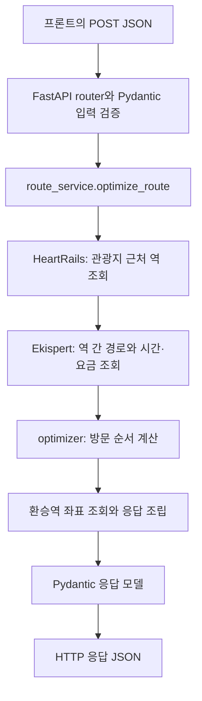

# 동선 최적화 백엔드

일차별 관광지 목록을 받아 방문 순서, 예상 도착 시각, 이동 구간과 교통비를 계산하는 FastAPI 서버다. 기존 실조회 flow를 API 서비스에 연결했다.

## 서버 실행 — 첫 번째 터미널

저장소 루트에서 시작한다. Python 3.12 이상과 Poetry를 사용한다.

```bash
cd backend
poetry install
xvfb-run -a poetry run uvicorn app.main:app --host 0.0.0.0 --port 8000
```

`Uvicorn running on http://0.0.0.0:8000`이 나오면 서버가 준비된 것이다. 이 터미널은 켜둔다.

이 크롤러는 Xvfb 안에서 `headless=False`인 Playwright Chromium을 실행한다. 실행 환경에 `xvfb-run`과 Playwright Chromium이 준비되어 있어야 한다. Chromium을 아직 설치하지 않았다면 `poetry run playwright install chromium`으로 설치한다.

서버가 실행되면 다음 주소를 사용한다.

| 주소 | 용도 |
| --- | --- |
| `http://localhost:8000/docs` | Swagger UI. 입력·출력 모델을 확인하고 요청을 보내는 화면 |
| `http://localhost:8000/openapi.json` | API 구조와 모델을 담은 OpenAPI JSON |
| `http://localhost:8000/api/routes/optimize` | 동선 최적화 요청 주소. HTTP `POST`로 호출 |

Codespaces에서는 8000번 포트를 전달한 주소 뒤에 `/docs`를 붙이면 된다. 이 최적화 flow에는 Google·Gemini API 키가 필요하지 않다. 관광지의 Google Place ID는 프론트가 검색 결과에서 얻어 전달한다.

## curl로 테스트 — 두 번째 터미널

`POST /api/routes/optimize`에 JSON 본문을 보낸다. 서버는 입력을 검증하고 외부 조회·최적화를 마친 뒤 결과 JSON을 HTTP 응답으로 돌려준다. 크롤링이 길어지면 응답을 받기까지 시간이 걸린다.

새 터미널을 열고 저장소 루트에서 아래 명령 전체를 복사해 실행한다. 요청 JSON이 명령 안에 있으므로 별도 테스트 파일이 필요 없다.

아래 `test-sensoji`, `test-tokyo-skytree`는 **curl 호출 확인용 임시 ID**다. 현재 서버는 Place ID를 필수 문자열로 검증하고 결과에 보존하며, 실제 Google ID인지 조회하지 않는다. 동선은 위도·경도로 계산하므로 이 예제도 실제 역·경로 조회를 수행한다. 프론트 연결 시에는 검색 결과의 실제 Google Place ID를 보낸다.

```bash
cd backend

curl -sS -X POST http://localhost:8000/api/routes/optimize \
  -H 'Content-Type: application/json' \
  --data-binary @- <<'JSON' | poetry run python -m json.tool --no-ensure-ascii
{
  "startDate": "2026-11-10",
  "dayCount": 1,
  "days": [
    {
      "dayIndex": 1,
      "dailyStartTime": "08:00",
      "places": [
        {
          "name": "센소지",
          "googlePlaceId": "test-sensoji",
          "location": {"lat": 35.7148, "lng": 139.7967}
        },
        {
          "name": "도쿄 스카이트리",
          "googlePlaceId": "test-tokyo-skytree",
          "location": {"lat": 35.7101, "lng": 139.8107}
        }
      ]
    }
  ]
}
JSON
```

결과 JSON은 두 번째 터미널에 출력되고, 서버·크롤링 로그는 첫 번째 터미널에서 확인한다. `--no-ensure-ascii`는 결과의 한글·일본어를 그대로 표시한다. 서버를 종료할 때는 첫 번째 터미널에서 `Ctrl+C`를 누른다.

이 요청은 관광지 2개이므로 성공하면 `days[0].visits`에 관광지 2개, `days[0].legs`에 이동 구간 1개가 들어간다. 방문 순서는 알고리즘이 정하며 역 좌표의 `lat`·`lng`는 모두 값이 있어야 한다. 이동 시간과 교통비는 실행 시 실제 조회한 결과에 따라 달라진다.

### 입력

| 필드 | 의미 |
| --- | --- |
| `startDate` | 여행 시작 날짜. `YYYY-MM-DD` |
| `dayCount` | 여행 일수. 1 이상의 정수 |
| `days` | 일차별 일정. 개수는 `dayCount`와 동일 |
| `days[].dayIndex` | `1`부터 `dayCount`까지 중복·누락 없는 일차 |
| `days[].dailyStartTime` | 일본 현지 시작 시각. `HH:mm`, 생략하면 `08:00` |
| `days[].places` | 하루 관광지 1~8개. 입력 순서는 최적 방문 순서가 아님 |
| `places[].name` | 관광지 이름. 최소 1글자 |
| `places[].googlePlaceId` | **필수** 관광지 Google Place ID. 빈 문자열이나 공백만 있는 값 불가 |
| `places[].location.lat` | 위도. -90~90 |
| `places[].location.lng` | 경도. -180~180 |

관광지 Google Place ID는 최적화 후에도 해당 관광지와 함께 보존된다. 역 정보에는 Google Place ID를 넣지 않는다.

### 출력

| 필드 | 의미 |
| --- | --- |
| `days[].visits` | 최적 방문 순서대로 정렬한 관광지. 이름·좌표·Google Place ID와 예상 도착 시각 포함 |
| `days[].legs` | 연속한 관광지 사이의 이동 구간. 관광지 n개이면 n-1개 |
| `legs[].route` | 해당 구간에서 이용하는 역과 노선의 순서 |
| `legs[].durationMinutes` | 구간 전체 소요 시간. 단위는 분 |
| `legs[].fare` | 구간 전체 교통비. 단위는 엔 |
| `days[].totalTravelMinutes`, `totalTransportFare` | 일차별 이동 시간·교통비 합계 |
| `totalTravelMinutes`, `totalTransportFare` | 여행 전체 이동 시간·교통비 합계 |

관광지 좌표와 역 좌표는 구분한다. 환승역까지 포함해 역 좌표를 조회하며, 좌표를 확보하지 못하면 오류로 중단한다. 응답 일시는 RFC 3339 형식이며 시간대는 `Asia/Tokyo`, 통화는 `JPY`다. 전체 필드와 스키마는 `/docs`에서 확인할 수 있다.

## 코드 구조와 요청 흐름

```text
app/
├── main.py                    # FastAPI app 생성, router 연결
├── api/routes.py              # POST /api/routes/optimize
├── schemas/route.py           # 요청·응답 Pydantic 모델
├── services/route_service.py  # async optimize_route(): 전체 계산 순서
├── clients/                   # HeartRails 등 외부 API 호출
├── crawling/                  # Ekispert 경로 크롤링
└── optimizer/                 # 이동 시간·요금을 이용한 방문 순서 최적화
```



- **Uvicorn**은 HTTP 요청을 받는 서버 프로그램이다. `app.main:app`은 `app/main.py`의 `app` 객체를 실행한다는 뜻이다.
- **FastAPI**는 URL·HTTP 메서드와 실행할 함수를 연결한다. `routes.py`는 요청을 받아 서비스에 전달하고 결과·오류를 HTTP 응답으로 돌려준다.
- **Pydantic**은 JSON이 정해진 모델에 맞는지 확인한다. 날짜, 시간, 필수 Google Place ID, 좌표와 일차 구성을 검증한다. 이 모델을 바탕으로 Swagger 문서도 생성한다.
- **서비스**는 근처 역 조회부터 최적 방문 순서와 응답 조립까지의 절차를 담당한다. API가 `optimize_route()`를 호출한다.
- **클라이언트·크롤러·최적화 모듈**은 각각 외부 데이터 수집과 순서 계산을 담당한다. HTTP 처리 코드를 이 모듈에 넣지 않는다.

동기 방식인 HeartRails 요청은 스레드에서 실행해 서버 이벤트 루프를 막지 않도록 한다. Chromium 부하를 줄이기 위해 앱 프로세스 하나당 최적화 작업을 한 번에 하나씩 실행한다. `--workers`를 늘리면 이 제한도 프로세스마다 따로 적용되므로 기본 실행 명령은 단일 프로세스를 사용한다.

프론트 개발 서버가 `http://localhost:3000` 또는 `http://localhost:5173`이면 브라우저 요청을 허용한다. 다른 주소를 쓰면 서버 실행 전에 `CORS_ORIGINS` 환경 변수에 허용할 주소를 쉼표로 구분해 지정한다. 이 값은 서버 시작 시 읽는다.

## 오류 응답

| HTTP 상태 | 의미 |
| --- | --- |
| `422` | 필수 Place ID 누락·빈 값, 날짜·일차·좌표 오류, 근처 역이나 사용할 경로 없음 |
| `502` | 외부 API 또는 크롤러 호출 실패 |
| `504` | 외부 조회 시간 초과 |

입력 검증 오류는 `{"detail": [...]}`로 필드별 오류를 반환한다. 역·경로 조회 오류는 `{"detail": "설명"}` 형식이다. 외부 서비스의 내부 오류와 서버 파일 경로를 응답에 그대로 노출하지 않는다.

성공 응답은 최적화가 완료된 JSON이다. 현재는 요청마다 계산해서 반환하며 DB 저장, 작업 큐, 작업 ID 조회, 인증은 구현 범위에 포함하지 않았다.

## 현재 계산 범위

- 각 일차의 방문 순서를 독립적으로 계산한다. 관광지를 다른 일차로 옮기지 않는다.
- 관광지마다 가까운 역 하나를 고른 뒤 역 사이 총 이동 시간을 최소화한다. 시간이 같으면 교통비를 비교한다.
- 첫 관광지에 `dailyStartTime`부터 이미 도착해 있다고 가정한다. 숙소에서 오는 이동과 마지막 장소에서의 복귀 구간은 없다.
- 모든 역 간 경로는 해당 일차의 시작 시각으로 조회한다. 순서 결정 후에는 구간 소요 시간을 누적하며 후속 구간의 실제 출발 시각으로 재조회하지 않는다.
- 관광지 체류 시간과 관광지↔역 도보 시간은 계산하지 않는다. 따라서 예상 도착 시각은 역 사이 이동 기준이다.
- 요금은 구간별 원본 운임의 합계다. 교통 패스·묶음 요금 할인은 반영하지 않는다.
