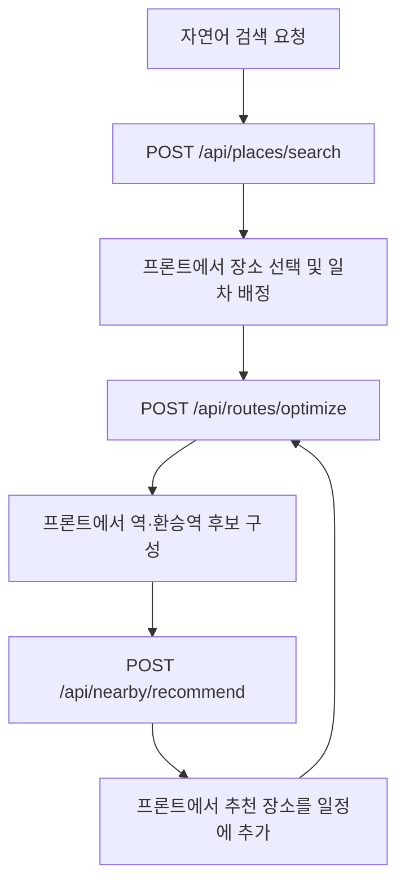

# JPass API 참조

이 디렉터리는 현재 FastAPI 구현의 HTTP 계약과 처리 흐름을 설명한다. AI 코드 생성·프론트 연동 시 먼저 이 문서를 읽고, 대상 API 문서와 OpenAPI의 해당 스키마를 함께 참조한다.

## 문서와 스키마

| 작업 | Method / Path | 상세 문서 | 요청 / 응답 모델 |
| --- | --- | --- | --- |
| 자연어로 장소 찾기 | `POST /api/places/search` | [text_search.md](text_search.md) | `PlaceSearchRequest` / `PlaceSearchResponse` |
| 일차별 방문 순서 계산 | `POST /api/routes/optimize` | [routes.md](routes.md) | `RouteRequest` / `RouteResponse` |
| 후보 역 주변 관광지 추천 | `POST /api/nearby/recommend` | [nearby.md](nearby.md) | `NearbyRequest` / `NearbyResponse` |

- **기계 판독용 HTTP 계약:** [openapi.json](openapi.json), OpenAPI 3.1.0. 모델은 `#/components/schemas/{모델명}`에 있다.
- **실행 중인 서버의 계약:** `GET /openapi.json`. Swagger UI는 `GET /docs`, ReDoc은 `GET /redoc`이다. 이 경로는 업무 API와 구분한다.
- **구현 원본:** [main.py](../app/main.py), [요청·응답 모델](../app/schemas), [라우터](../app/api), [서비스](../app/services).
- 실행·API 키·Chromium 설치 안내는 [backend README](../README.md)를 참조한다.
- 컨테이너 실행은 [Docker 안내](docker.md), 로컬 Kubernetes 배포는 [minikube 안내](kubernetes.md)를 참조한다.
- Git 설정을 읽는 Argo CD 배포와 UI 접속은 [Argo CD 실습 안내](argocd.md)를 참조한다.

JSON 형태·필수 필드·타입은 OpenAPI와 모델을 확인한다. 순차 처리, 검색 생략, 최적화의 계산 범위처럼 스키마만으로 표현할 수 없는 의미는 각 API의 Flow와 제한을 확인한다. 예시의 장소·ID는 구조 설명용이며 외부 서비스가 해당 결과를 반환한다는 의미는 아니다.

## 공통 HTTP 규칙

| 항목 | 현재 동작 |
| --- | --- |
| Base URL | 배포 환경의 서버 주소. 로컬 기본 실행 예시는 `http://localhost:8000` |
| 요청 형식 | `Content-Type: application/json`, 본문은 JSON 객체 |
| 정상 응답 | HTTP `200`, API별 응답 모델의 JSON |
| 처리 방식 | 요청 안에서 외부 조회·계산을 완료한다. 작업 ID나 폴링 API 없음 |
| 인증 | 현재 인증 구현 없음 |
| 저장 | DB 저장·대화 이력·요청 간 결과 캐시 없음 |
| 비밀값 | API 키는 서버 환경 변수로 관리한다. 요청 JSON에 API 키를 넣지 않는다 |
| 추가 필드 | 장소 검색 요청과 중첩 위치 모델은 거부(`422`). 동선·주변 추천 모델은 Pydantic 기본값에 따라 무시 |
| nullable | `null` 허용과 필드 생략 가능 여부는 서로 다르다. OpenAPI의 `required`와 nullable 타입을 각각 확인 |
| 응답 기본값 | 선택 필드의 기본값·`null`도 일반 응답 직렬화에 포함될 수 있다 |

서버는 시작 시 저장소 루트 `.env`를 읽으며 이미 설정된 환경 변수는 덮어쓰지 않는다. `lifespan`에서 필수 환경 변수 `GOOGLE_PLACE_API_KEY`, `GEMINI_API_KEY`, `GEMINI_MODEL`의 존재 여부를 검증하며, 하나라도 미설정·빈 문자열·공백뿐이면 앱 시작이 실패한다. 실제 외부 API를 호출해 키나 모델의 유효성을 확인하지는 않는다. `CORS_ORIGINS`의 기본 허용 주소는 `http://localhost:3000`, `http://localhost:5173`이고, 쉼표로 구분한 환경 변수로 바꿀 수 있다. 허용 메서드는 `POST`, 허용 요청 헤더는 `Content-Type`이다.

## 좌표·단위·시간

| 데이터 | JSON 필드 | 단위·규칙 |
| --- | --- | --- |
| 동선·주변 추천의 좌표 | `location.lat`, `location.lng` | 위도 `-90~90`, 경도 `-180~180` |
| 장소 검색 위치 조건·Google 원본 좌표 | `latitude`, `longitude` | 위도 `-90~90`, 경도 `-180~180` |
| 검색 반경·역과 장소의 직선거리 | `radius`, `distanceMeters` | 미터. 도보 경로 거리·시간과 구분 |
| 동선 소요 시간 | `durationMinutes`, `totalTravelMinutes` | 분 |
| 동선 교통비 | `fare`, `totalTransportFare` | 엔, `currency: "JPY"` |
| 동선 날짜 | `startDate`, `date` | `YYYY-MM-DD` |
| 일차 시작 시각 | `dailyStartTime` | `HH:mm`, 일본 현지 시각 |
| 동선 응답 일시 | `startAt`, `endAt`, 도착·출발 일시 | 시간대가 있는 RFC 3339, `timezone: "Asia/Tokyo"` |

## API 선택과 데이터 연결



각 API는 독립적이며 위 연결은 프론트가 구성한다. 동선 최적화 API가 주변 추천 API를 자동 호출하지 않는다.

| 원본 | 동선 최적화의 `days[].places[]` 필드 |
| --- | --- |
| 장소 검색 `results[].response.places[].id` | `googlePlaceId` |
| 장소 검색 `displayName.text` | `name` |
| 장소 검색 `location.latitude`, `location.longitude` | `location.lat`, `location.lng` |
| 주변 추천 `recommendedPlaces[].googlePlaceId`, `name`, `location` | 같은 필드명을 사용 |

동선 응답의 역은 `visits[].station`과 `legs[].route[].fromStation/toStation`에 있다. 프론트에서 필요한 후보를 추리고 `stations` 배열을 구성한다. `stationId`는 프론트가 부여하는 선택 필드이며 Google Place ID와 다르다. 필요한 `line`은 이동 구간의 `line`에서 구성할 수 있다.

## API별 핵심 분기와 경계

| API | 반드시 유지할 동작 |
| --- | --- |
| 장소 검색 | 일본어 검색어 최대 3개. Google 호출은 한국어 `ko`, 지역 `JP` 고정. 요청에는 언어·지역 필드 없음 |
| 장소 검색 | 모호해서 검색어 생성이 불가능하면 `textQueries: null`, `results: []`를 HTTP `200`으로 반환. 추가 질문 필드 없음, Google 호출 없음 |
| 장소 검색 | Google 원본 JSON을 검색어별로 반환. 장소 필드 누락 가능. 자동 다음 페이지 조회·검색어 간 장소 중복 병합 없음 |
| 동선 최적화 | 하루 1~8곳, 일차 간 장소 재배정 없음. 시간 최소 후 동률이면 교통비 비교 |
| 동선 최적화 | 첫·마지막 장소는 고정하지 않음. 숙소·복귀·체류·관광지 접근 도보 제외. 모든 역 쌍은 그날 시작 시각으로 조회 |
| 주변 추천 | 앵커 역 선택 후 역마다 최대 `placeCount`개. 단일 태그는 검색 순서 유지 |
| 주변 추천 | 복수 태그는 후보 예산 `2 × placeCount`를 배분. 정제 후 후보가 2개 이상이면 역별 LLM 재순위화 |
| 주변 추천 | 역 안에서 장소 중복 제거, 역 사이 중복은 유지. 부족한 개수를 채우는 추가 검색 없음 |

장소 검색·주변 추천은 동기 핸들러로 FastAPI 작업 스레드에서 실행한다. 각 요청 내부의 외부 호출은 순차 처리한다. 동선 최적화는 비동기 핸들러이며 앱 프로세스마다 하나의 요청만 잠금을 얻어 실행한다. 이 잠금은 다른 API나 다른 worker 프로세스와 공유하지 않는다.

## 오류 계약

입력 검증 오류의 본문은 `{"detail": [...]}`이다. 라우터가 분류한 서비스 오류의 본문은 `{"detail": "설명"}`이다.

| HTTP 상태 | 장소 검색 | 주변 추천 | 동선 최적화 |
| --- | --- | --- | --- |
| `422` | 입력 검증 실패 | 입력 검증 실패 | 입력 검증 실패, 사용할 역·경로·좌표 없음 |
| `429` | Google/Gemini 사용량 제한 | Google/Gemini 사용량 제한 | 별도 매핑 없음 |
| `502` | 외부 호출·응답 검증 실패 | 외부 호출·응답 검증 실패 | 외부 역 조회·크롤링 실패, 처리 가능한 응답 형식 오류 |
| `504` | 외부 호출 시간 초과 | 외부 호출 시간 초과 | 외부 역 조회·크롤링 시간 초과 |

서비스 중간에 실패하면 이전 검색어·역·일차의 부분 결과를 반환하지 않는다. 표는 라우터가 명시적으로 처리하는 오류이며, 분류되지 않은 예외는 일반 서버 오류가 될 수 있다. 외부 호출별 시간 제한은 있지만 요청 전체에 대한 단일 deadline이나 애플리케이션 수준의 재시도 루프는 없다. SDK 자체의 재시도와 서비스 코드의 논리적 호출 횟수는 구분한다.

## OpenAPI 스냅샷 갱신

저장소 루트에서 다음 명령으로 현재 앱의 HTTP 스키마를 생성한다. 외부 API를 호출하거나 서버를 실행할 필요는 없다.

```bash
cd backend
poetry run python -c 'import json; from pathlib import Path; from app.main import app; Path("docs/openapi.json").write_text(json.dumps(app.openapi(), ensure_ascii=False, indent=2) + "\n", encoding="utf-8")'
```

스키마·라우터를 변경하면 이 스냅샷과 대상 API 문서를 함께 갱신한다. 내부 LLM용 `QueryRewrite`, `AnchorStationSelection`, `RecommendedPlaceRanking`은 HTTP 모델이 아니므로 OpenAPI의 공개 API 모델과 구분한다.
