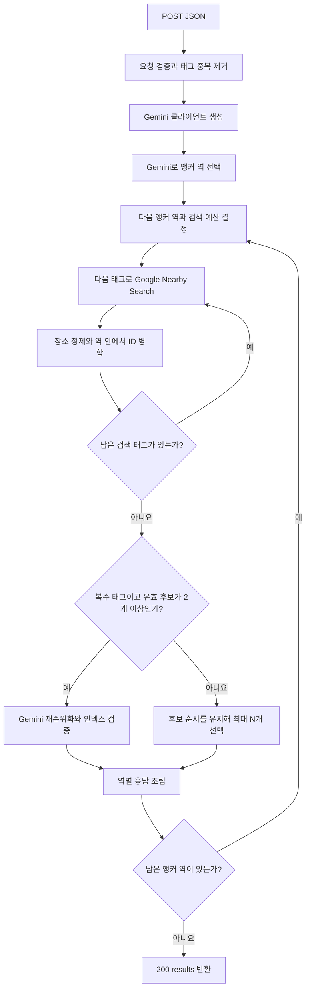

# 역 주변 관광지 추천 API

이 문서는 현재 코드의 HTTP 계약과 실행 흐름을 설명한다. 후보 역 중 검색 기준이 될 역을 Gemini로 선택한 뒤 Google Places Nearby Search로 주변 장소를 찾는다. 복수 여행 태그의 유효 후보가 2개 이상이면 Gemini가 최종 장소와 순서를 정한다.

## Endpoint

| 항목 | 값 |
| --- | --- |
| Method | `POST` |
| Path | `/api/nearby/recommend` |
| Request Content-Type | `application/json` |
| Success Content-Type | `application/json` |
| Success Status | `200` |
| Request model | `NearbyRequest` |
| Response model | `NearbyResponse` |

API 키는 서버 환경 변수에서 읽으며 요청 본문에 전달하지 않는다. 앱의 `lifespan`에서 `GOOGLE_PLACE_API_KEY`, `GEMINI_API_KEY`, `GEMINI_MODEL`을 검증하며, 하나라도 미설정·빈 문자열·공백뿐이면 앱 시작이 실패한다. 서비스는 요청마다 설정 누락을 다시 확인하지 않는다. 시작 시 실제 외부 API를 호출해 키나 모델의 유효성을 확인하지는 않는다. 주변 추천 모델은 선택 설정인 `GEMINI_NEARBY_MODEL`을 우선 사용하며, 해당 값이 미설정·빈 문자열·공백뿐이면 공통 기본 모델인 `GEMINI_MODEL`을 사용한다. 모델의 앞뒤 공백은 제거하며 코드에 고정된 모델명으로 대체하지 않는다. 저장소의 모델 설정 예시는 모두 `gemini-3.5-flash-lite`이며, nearby 모델만 바꾸려면 `GEMINI_NEARBY_MODEL`을 수정한다.

## Source code

| 역할 | 소스 |
| --- | --- |
| FastAPI 라우터·HTTP 오류 변환 | [app/api/nearby.py](../app/api/nearby.py) |
| HTTP 모델·내부 LLM 결과 모델 | [app/schemas/nearby.py](../app/schemas/nearby.py) |
| 공통 `Location` 모델 | [app/schemas/route.py](../app/schemas/route.py) |
| 앵커 선정·검색 예산·정제·추천 조립 | [app/services/nearby_service.py](../app/services/nearby_service.py) |
| 장소 재순위화 프롬프트 | [app/prompts/nearby_ranking.py](../app/prompts/nearby_ranking.py) |
| 여행 태그·Google 장소 유형 매핑 | [app/constants/place_types.py](../app/constants/place_types.py) |
| Google Nearby Search | [app/clients/google_maps.py](../app/clients/google_maps.py)의 `search_nearby()` |
| Gemini 요청·구조화 출력 파싱 | [app/llm/llm_wrapper.py](../app/llm/llm_wrapper.py)의 `GeminiWrapper` |
| 외부 서비스의 공통 오류 타입·상태 분류 | [app/errors.py](../app/errors.py) |
| 앱 등록·환경 변수·CORS | [app/main.py](../app/main.py) |

## Input Schema

### NearbyRequest

| 필드 | JSON 타입 | 필수 | nullable | 기본값 | 제약·동작 |
| --- | --- | --- | --- | --- | --- |
| `travelTypes` | array of string | 예 | 아니요 | 없음 | 1개 이상. 아래 허용 태그만 사용. 중복을 입력 순서대로 제거 |
| `userRequest` | string | 아니요 | 아니요 | `""` | 자유 요청 문장. 길이 제한·공백 제거 없음 |
| `stations` | array of StationInput | 예 | 아니요 | 없음 | 1개 이상. 개수 상한·역 중복 제거 없음 |
| `placeCount` | integer | 예 | 아니요 | 없음 | `1 <= 값 <= 20`. 엄격한 정수: 문자열·소수·boolean 거부. 선택된 역 하나당 반환 개수 상한 |
| `radius` | number | 예 | 아니요 | 없음 | 미터. `0 < 값 <= 50000`. NaN·무한대 거부 |
| `maxAnchorCount` | integer | 아니요 | 예 | `null` | 1 이상 엄격한 정수. `null`이면 `max(1, 역 수 // 2)`, 지정값이 역 수보다 크면 역 수로 제한 |

허용 `travelTypes`: `culture`(역사·문화), `nature`(자연·풍경), `anime`(애니메이션), `shopping`(쇼핑), `relaxation`(휴식·힐링), `activity`(액티비티). 태그의 대소문자 변환이나 공백 제거는 하지 않는다.

### stations[]: StationInput

| 필드 | JSON 타입 | 필수 | nullable | 기본값 | 제약·동작 |
| --- | --- | --- | --- | --- | --- |
| `name` | string | 아니요 | 예 | `null` | 역 이름. 최소 길이 제약 없음 |
| `stationId` | string | 아니요 | 예 | `null` | 호출자가 관리하는 역 ID. 고유성 검증 없음. 응답에 그대로 보존 |
| `line` | string | 아니요 | 예 | `null` | 앵커 선정에 참고할 노선. HTTP 응답에서는 제외 |
| `location` | Location | 예 | 아니요 | 없음 | 역의 좌표 |

### Location

| 필드 | JSON 타입 | 필수 | nullable | 기본값 | 제약 |
| --- | --- | --- | --- | --- | --- |
| `lat` | number | 예 | 아니요 | 없음 | `-90 <= 값 <= 90` |
| `lng` | number | 예 | 아니요 | 없음 | `-180 <= 값 <= 180` |

`NearbyRequest`, `StationInput`, `Location`에 정의되지 않은 추가 필드는 Pydantic 기본 설정으로 무시한다. `radius`, `lat`, `lng`에는 엄격한 숫자 타입 검사를 설정하지 않아 Pydantic이 변환 가능한 숫자 입력을 변환한다. 프론트는 JSON number를 사용한다.

### Valid request example

```json
{
  "travelTypes": ["culture", "nature"],
  "userRequest": "박물관을 먼저 보고 근처에서 산책하고 싶어요.",
  "stations": [
    {
      "stationId": "station-1",
      "name": "후보 역 1",
      "line": "노선 A",
      "location": {"lat": 35.701, "lng": 139.8}
    },
    {
      "stationId": "station-2",
      "name": "후보 역 2",
      "line": "노선 B",
      "location": {"lat": 35.702, "lng": 139.801}
    }
  ],
  "placeCount": 2,
  "radius": 1000,
  "maxAnchorCount": 1
}
```

## Output Schema

성공 응답의 최상위 키는 `results`다. 각 결과는 선택된 역 하나에 대응하며 앵커 LLM의 선택 순서를 따른다. 응답 모델의 선택 필드도 기본 직렬화에서 `null`로 포함된다.

| 경로 | JSON 타입 | 필수 | nullable | 모델 기본값 | 제약·실제 값 |
| --- | --- | --- | --- | --- | --- |
| `results` | array of StationRecommendations | 예 | 아니요 | 없음 | 최소 1개. 선택된 앵커 역 수만큼 반환 |
| `results[].station` | StationOutput | 예 | 아니요 | 없음 | 선택된 입력 역 |
| `results[].radius` | number | 예 | 아니요 | 없음 | 입력 `radius`를 보존. 응답 모델 자체에는 범위 제약 없음 |
| `results[].requestedCount` | integer | 예 | 아니요 | 없음 | 모델 제약 1 이상. 실제 값은 입력 `placeCount` |
| `results[].returnedCount` | integer | 예 | 아니요 | 없음 | 모델 제약 0 이상. 실제 `recommendedPlaces` 길이 |
| `results[].recommendedPlaces` | array of RecommendedPlace | 예 | 아니요 | 없음 | 모델 자체에 길이 제약 없음. 서비스는 0~`placeCount`개 반환 |

### results[].station: StationOutput

| 필드 | JSON 타입 | 필수 | nullable | 모델 기본값 | 의미 |
| --- | --- | --- | --- | --- | --- |
| `name` | string | 아니요 | 예 | `null` | 입력 역 이름 |
| `stationId` | string | 아니요 | 예 | `null` | 입력 역 ID |
| `location` | Location | 예 | 아니요 | 없음 | 입력 역 좌표. 위 `Location`과 같은 범위 제약 |

### results[].recommendedPlaces[]: RecommendedPlace

| 필드 | JSON 타입 | 필수 | nullable | 모델 기본값 | 제약·의미 |
| --- | --- | --- | --- | --- | --- |
| `googlePlaceId` | string | 예 | 아니요 | 없음 | 최소 1자, 공백 외 문자 포함. Google 응답 `id` |
| `name` | string | 예 | 아니요 | 없음 | 최소 1자, 공백 외 문자 포함. Google `displayName.text` |
| `location` | Location | 예 | 아니요 | 없음 | Google `latitude/longitude`를 `lat/lng`로 변환 |
| `address` | string | 아니요 | 예 | `null` | 문자열인 `formattedAddress`; 없거나 문자열이 아니면 `null` |
| `primaryType` | string | 아니요 | 예 | `null` | 문자열인 `primaryType`; 없거나 문자열이 아니면 `null` |
| `searchTags` | array of string | 예 | 아니요 | 없음 | 최소 1개. 해당 장소를 찾은 검색 태그들을 중복 없이 병합 |
| `distanceMeters` | number | 예 | 아니요 | 없음 | 0 이상 유한값. 기준 역과의 구면 직선거리, 소수점 첫째 자리까지 반올림 |

Google 원본 응답의 `types`, `displayName.languageCode`, 평점·영업시간·지도 URL 등은 이 응답에 포함되지 않는다.

### Success response example

앞의 요청에서 `station-1`이 선택되고 유효 후보 2개가 정렬된 경우의 HTTP `200` JSON 예시다. 예시 이름·ID는 구조 설명용이며 외부 API 실검색 결과를 뜻하지 않는다. 필드·좌표 변환·거리 반올림은 실제 응답 모델과 서비스 동작을 따른다.

```json
{
  "results": [
    {
      "station": {
        "name": "후보 역 1",
        "stationId": "station-1",
        "location": {"lat": 35.701, "lng": 139.8}
      },
      "radius": 1000.0,
      "requestedCount": 2,
      "returnedCount": 2,
      "recommendedPlaces": [
        {
          "googlePlaceId": "example-museum-1",
          "name": "예시 박물관",
          "location": {"lat": 35.7012, "lng": 139.8},
          "address": null,
          "primaryType": "museum",
          "searchTags": ["culture"],
          "distanceMeters": 22.2
        },
        {
          "googlePlaceId": "example-park-1",
          "name": "예시 공원",
          "location": {"lat": 35.7011, "lng": 139.8},
          "address": null,
          "primaryType": "park",
          "searchTags": ["nature"],
          "distanceMeters": 11.1
        }
      ]
    }
  ]
}
```

검색된 유효 장소가 없어도 해당 역 결과를 생략하지 않는다. `returnedCount`는 `0`, `recommendedPlaces`는 `[]`이며 HTTP `200`이다.

## Flow

1. FastAPI가 요청을 검증하고 중복 여행 태그를 제거한다. 검증 실패는 외부 호출 전에 `422`로 끝난다.
2. 서버가 시작 시 검증한 설정으로 Gemini 클라이언트 하나를 생성한다.
3. 각 입력 역에 위치 기반 ID `candidate-1`, `candidate-2`, …를 부여한다. Gemini에 `userRequest`, `travelTypes`, 후보 역의 이름·ID·노선·좌표, 최소·최대 선택 개수를 보낸다. LLM 결과의 고유 후보 ID를 검증한 뒤 원래 입력 역 객체로 연결한다. 입력 역이 하나여도 이 호출은 수행한다.
4. 선택된 역을 LLM 반환 순서대로 하나씩 처리한다. 역마다 검색 계획을 새로 만든다. 단일 태그면 최대 `N=placeCount`개, 복수 태그면 전체 후보 예산 `2N`을 태그별로 나눈다.
5. 해당 역의 검색 계획 순서대로 Google Nearby Search를 호출한다. `includedTypes`는 태그별 상수 목록, 중심은 역 좌표, 반경은 입력 `radius`, `rankPreference`는 `DISTANCE`, `languageCode`는 `ko`, `regionCode`는 `JP`다. 태그에 배정된 개수를 `maxResultCount`로 보낸다.
6. 태그별 응답의 앞쪽 배정 개수만 확인한다. ID·이름·좌표가 누락되거나 올바르지 않은 장소, 서버가 다시 계산한 직선거리가 반경보다 큰 장소를 제거한다.
7. 같은 역의 장소를 `googlePlaceId`로 병합한다. 첫 등장 장소 정보를 유지하고 후속 검색 태그만 `searchTags`에 추가한다. 서로 다른 역 사이에서는 중복을 제거하지 않는다.
8. 단일 태그면 Google 검색 순서를 유지해 앞쪽 최대 `N`개를 반환한다. 복수 태그여도 유효 후보가 0~1개면 그대로 반환한다. **복수 태그이며 정제·중복 제거 후 후보가 2개 이상이면 Gemini를 한 번 더 호출한다.** 후보가 `N`개 이하여도 순서를 정하기 위해 호출한다.
9. 재순위화는 `min(N, 후보 수)`개의 고유 인덱스를 검증하고 그 순서대로 원래 장소 객체를 선택한다. 역별 응답을 조립하고 다음 역을 처리한다.
10. 모든 역을 마치면 `NearbyResponse`를 반환하고 `with` 블록을 나가며 Gemini 클라이언트를 닫는다. 정리 실패는 래퍼가 로그로 남기며 기존 결과·오류를 유지한다. 도중 외부 호출·응답 검증이 실패하면 전체 요청이 실패하며 앞서 완료된 역의 부분 결과도 반환하지 않는다.



### 복수 태그 검색 예산의 무작위성

중복 제거 후 태그 수를 `T`, 역당 요청 개수를 `N`이라고 한다.

- 단일 태그는 검색 계획 `[(태그, N)]`을 사용한다.
- 복수 태그는 `min(T, 2N)`개 태그를 `random.sample`로 선택하고 순서도 섞는다.
- `2N`을 선택된 태그 수로 나눈 몫을 각 태그에 배정하며, 나머지만큼 섞인 순서의 앞쪽 태그에 1개씩 더 배정한다.
- 예: `N=5`, `T=3`이면 태그별 `4+3+3`개. `N=1`, `T=6`이면 무작위 태그 2개를 각각 1개씩 검색한다.
- 검색 계획은 역마다 다시 정한다. 후보가 부족하거나 중복·무효 장소가 제거되어도 추가 조회나 예산 재분배는 없다.

## Internal LLM contracts

아래 JSON은 서버와 Gemini 사이의 내부 계약이다. 프론트 HTTP 요청·응답에는 `candidateIds`와 `indices`를 추가하지 않는다.

### 앵커 선정: AnchorStationSelection

```json
{"candidateIds": ["candidate-1"]}
```

`candidateIds`는 1개 이상 고유 문자열 배열이다. 요청마다 생성하는 JSON Schema에 선택 상한과 실제 후보 ID의 `enum`을 넣는다. 로컬에서도 중복, 최대 선택 개수, 입력에 없는 ID를 검증한다. 추가 키는 거부한다. 정보가 부족하거나 후보의 우열을 가릴 수 없으면 첫 후보 하나를 선택하도록 프롬프트에서 지시한다.

앵커 선택의 출력 토큰 상한은 `GeminiWrapper.request()` 기본값인 1024다.

### 재순위화: RecommendedPlaceRanking

```json
{"indices": [1, 0]}
```

LLM 입력은 `userRequest`, `travelTypes`, 선택 개수, 후보의 `index`, `name`, `primaryType`, `searchTags`, `distanceMeters`다. 장소 ID·주소·좌표는 보내지 않는다. 후보별 평점·영업시간 등 입력에 없는 사실을 추측하지 않도록 지시하며, 관련성이 불분명하거나 동률이면 가까운 거리와 작은 인덱스를 우선하도록 한다.

`indices`는 엄격한 0 이상의 정수 배열이며 기본 모델 길이는 1~20이다. 동적 JSON Schema에는 길이를 정확히 `min(N, 후보 수)`로 지정하고 실제 후보 인덱스의 `enum`을 넣는다. 서버는 개수·고유성·정수 여부·범위·추가 키를 검증한다. 출력 토큰 상한은 256이다. 검증 실패 시 임의의 순위나 검색 순서로 대체하지 않고 `502`로 실패한다.

## HTTP errors

| Status | 실제 분류 | 응답 detail |
| --- | --- | --- |
| `422` | 필수값 누락, 미지원 태그, 빈 역·태그 목록, 잘못된 개수·반경·좌표 등 FastAPI/Pydantic 요청 검증 실패 | 검증 오류 배열 |
| `429` | Gemini `APIError.code == 429`, Google HTTP 429 | `외부 추천 서비스의 요청 한도를 초과했습니다. 잠시 후 다시 시도해주세요.` |
| `502` | 그 외 Gemini API 오류·Google HTTP 오류, 연결 오류, 잘못된 JSON·응답 형식, 앵커·순위 결과 검증 실패, 차단·미완료·빈 LLM 출력 등 | `외부 추천 서비스에서 정상적인 응답을 받지 못했습니다.` |
| `504` | `requests.Timeout`, `httpx.TimeoutException`, Gemini 또는 Google의 408·504 | `외부 추천 서비스 응답 시간이 초과되었습니다.` |

서비스 오류 형식은 `{"detail": "설명"}`이다. 외부 응답 본문이나 API 키를 HTTP detail에 넣지 않는다. 오류가 나면 전체 요청을 종료하며 부분 성공·애플리케이션의 명시적 재시도·재순위화 실패 시 대체 결과는 없다. 위 표는 코드가 변환하는 예외에 대한 계약이며 처리되지 않은 예외까지 모두 이 표의 상태로 변환하는 것은 아니다.

LLM 래퍼와 Google 클라이언트는 호출 제한·시간 초과·연결 실패·응답 형식 오류를 공통 `Provider*` 예외로 변환한다. 서비스는 검증된 LLM 모델을 사용하며 현재 요청의 후보 ID·선택 개수·인덱스 범위만 추가로 검사한다. API는 공통 예외를 HTTP 상태로 변환하며, 내부 코드의 일반 `TypeError`·`AttributeError` 등을 외부 서비스 오류로 묶지 않는다.

## 호출 수와 동시성

`A`는 실제 선택된 앵커 역 수, `T`는 중복 제거 후 태그 수, `N`은 `placeCount`, `R`은 복수 태그 요청에서 유효 후보가 2개 이상인 앵커 역 수다. 성공 완료까지 애플리케이션이 실행하는 논리적 호출 수는 다음과 같다.

| 외부 서비스 | 단일 태그 | 복수 태그 |
| --- | --- | --- |
| Google Nearby Search | `A` | `A × min(T, 2N)` |
| Gemini | 앵커 선정 `1` | 앵커 선정 `1` + 재순위화 `R` |
| Geocoding·HeartRails·Ekispert | `0` | `0` |

앵커 수는 항상 1 이상이며, 기본 상한은 `max(1, 입력 역 수 // 2)`다. 명시한 `maxAnchorCount`는 선택을 허용하는 상한이므로 LLM이 그보다 적게 선택할 수 있다.

Google `requests.post`의 timeout은 호출당 30초, Gemini SDK HTTP timeout은 호출당 30,000ms다. 전체 API 요청의 별도 총 시간 제한은 없다. 표는 코드 수준의 호출 수로 SDK 내부의 네트워크 재시도까지 센 값은 아니다.

라우터는 동기 `def`로 FastAPI 작업 스레드에서 실행한다. 요청 하나 안에서는 앵커 선정 → 첫 역의 태그별 검색 → 해당 역 재순위화 → 다음 역 순서로 모두 직렬 실행한다. 별도 병렬 처리·캐시·요청 간 잠금은 없다. 서로 다른 HTTP 요청은 FastAPI 실행 환경에서 동시에 진행할 수 있다. 한 HTTP 요청 안에서는 동일 Gemini 클라이언트를 재사용한다.

## 경계 조건과 프론트 연결

- 프론트는 추천 후보 역의 좌표를 제공해야 한다. 서버가 역 ID·이름으로 좌표를 재조회하지 않으며 해당 역의 실재 여부도 검증하지 않는다.
- `stationId`를 보존해 입력 역과 결과를 연결할 수 있다. 같은 ID나 좌표가 반복된 역도 입력 후보에서 별도로 취급한다. 출력의 역·장소 이름은 `null` 허용 여부가 서로 다르다: 역 이름은 `null` 가능, 추천 장소 이름은 필수다.
- `placeCount`는 역당 상한이다. 전체 장소 수는 최대 `A × N`이며 후보 부족으로 줄어들 수 있다. `results`를 입력 역 전체에 대응하는 배열로 가정하지 않는다.
- `userRequest`는 앵커 선정에 항상 전달된다. 단일 태그의 장소 순서에는 추가 LLM 판단을 적용하지 않는다. 복수 태그의 후보가 2개 이상일 때만 장소 선정·순위에도 반영한다. Google 요청에는 자유 문장을 보내지 않는다.
- 같은 역 안에서는 장소 ID가 합쳐지지만 서로 다른 역의 추천에 같은 장소가 나타날 수 있다. `searchTags`는 실제 태그 검색에서 나온 기록이며 장소가 그 취향을 확실히 만족한다는 추가 판정은 아니다.
- `distanceMeters`는 도보 경로나 소요 시간이 아닌 직선거리다. 포함 여부는 반올림 전 거리로 판단한다. LLM 재순위화 후에는 거리 오름차순이 아닐 수 있다.
- 좌표가 없는 장소나 반경 밖 장소는 제거한다. 입력 역 자체를 장소 결과에서 제외하는 별도 규칙이나 평점·혼잡도·영업 여부 필터는 없다.
- 지도 마커는 `location`, 장소 식별은 `googlePlaceId`, 결과 순서는 `recommendedPlaces` 배열 순서를 사용한다. 응답의 `line`, 앵커 선정 이유, 후보 인덱스는 없다.
- 요청을 브라우저에서 보낼 때는 JSON `POST`를 사용한다. 허용 origin은 서버 `CORS_ORIGINS`로 설정하며 기본값은 `http://localhost:3000,http://localhost:5173`이다.
