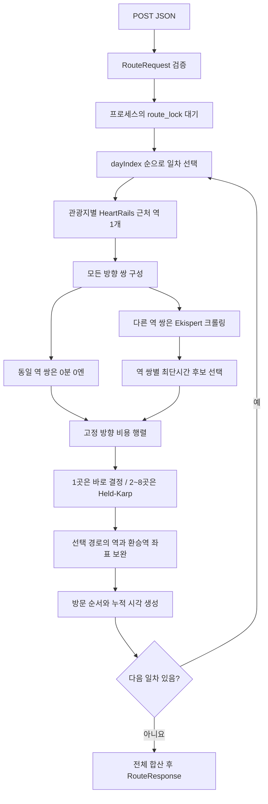

# 동선 최적화 API

이 문서는 현재 워킹 트리의 실제 구현을 설명한다. 관광지별 좌표로 근처 역을 찾고, 일차별 역 간 이동 시간을 기준으로 방문 순서를 계산한다. 관광지 체류 시간과 관광지↔역 접근 도보는 계산하지 않는다.

## Endpoint

| 항목 | 값 |
| --- | --- |
| Method | `POST` |
| Path | `/api/routes/optimize` |
| Request Content-Type | `application/json` |
| Success status | `200` |
| Success Content-Type | `application/json` |
| 인증 | 현재 API에 인증 의존성이 없음 |
| 시각·요금 단위 | 일본 현지 시각 `Asia/Tokyo`, 분, 일본 엔 `JPY` |

코드 참조:

- HTTP 라우터와 예외 매핑: [routes.py](../app/api/routes.py)
- 입출력 모델·입력 검증: [route.py](../app/schemas/route.py)
- 처리 순서·응답 조립: [route_service.py](../app/services/route_service.py)
- 역 API: [heartrails.py](../app/clients/heartrails.py)
- 경로 수집·파싱: [ekispert.py](../app/crawling/ekispert.py), [parsers.py](../app/crawling/parsers.py), [browser.py](../app/crawling/browser.py)
- 고정 비용 최적화: [matrix.py](../app/optimizer/matrix.py), [optimizer.py](../app/optimizer/optimizer.py)
- 앱 등록·요청 잠금·CORS: [main.py](../app/main.py)

## JSON Schema와 실행 의미

기계가 읽을 구조는 [openapi.json](./openapi.json)의 `paths["/api/routes/optimize"].post` 및 `components.schemas`에 있다. 실행 중인 서버의 `/openapi.json`에서도 확인할 수 있다. 아래 표의 필수·nullable·기본값은 Pydantic 모델 선언을 따른다. `없음`은 해당 필드를 생략할 수 없다는 뜻이다. nullable은 JSON `null` 허용 여부다.

JSON Schema만으로 표현되지 않는 관계 검증과 계산 의미는 별도로 설명한다. JSON Schema의 기본값은 서버가 필드를 생략했을 때 적용하는 값이며, 임의의 JSON Schema 검증기가 기본값을 자동 삽입한다는 뜻은 아니다.

현재 모델은 선언되지 않은 추가 입력 필드를 무시한다. `dayCount`와 `dayIndex`는 엄격한 정수이지만, 좌표는 Pydantic `float`의 기본 변환을 사용한다. 프론트는 아래 JSON 타입대로 전달한다.

## Input Schema

### RouteRequest

| 필드 | JSON 타입 / 모델 | 필수 | nullable | 기본값 | 제약 |
| --- | --- | --- | --- | --- | --- |
| `startDate` | string, date | 예 | 아니요 | 없음 | 정확한 `YYYY-MM-DD` 형식의 유효한 날짜 |
| `dayCount` | integer | 예 | 아니요 | 없음 | 1 이상, 엄격한 정수. 문자열·실수·boolean 불가 |
| `days` | array of DayInput | 예 | 아니요 | 없음 | 아래 관계 검증 적용 |

실행 시 추가 검증:

1. `days.length == dayCount`여야 한다.
2. `dayIndex`는 `1..dayCount`를 각각 한 번씩 포함해야 한다. 배열 입력 순서는 자유다.
3. `startDate + dayCount - 1`이 `9999-12-31`을 넘으면 거절한다.
4. 과거 날짜를 금지하는 검증과 별도의 최대 여행 일수는 없다.

### DayInput

| 필드 | JSON 타입 / 모델 | 필수 | nullable | 기본값 | 제약 |
| --- | --- | --- | --- | --- | --- |
| `dayIndex` | integer | 예 | 아니요 | 없음 | 1 이상, 엄격한 정수. RouteRequest 관계 검증 적용 |
| `dailyStartTime` | string | 아니요 | 아니요 | `"08:00"` | 정규식 `^([01][0-9]|2[0-3]):[0-5][0-9]$` |
| `places` | array of PlaceInput | 예 | 아니요 | 없음 | 1~8개 |

일차의 날짜는 `startDate + dayIndex - 1`이다. `dailyStartTime`은 이 날짜의 일본 현지 시각으로 해석한다. 장소 입력 순서는 시작점이나 방문 순서를 고정하지 않는다.

### PlaceInput

| 필드 | JSON 타입 / 모델 | 필수 | nullable | 기본값 | 제약 |
| --- | --- | --- | --- | --- | --- |
| `name` | string | 예 | 아니요 | 없음 | 길이 1 이상. 공백 제거 검증은 없음 |
| `location` | Location | 예 | 아니요 | 없음 | 관광지 좌표 |
| `googlePlaceId` | string | 예 | 아니요 | 없음 | 길이 1 이상, 정규식 `\S`로 공백 이외 문자 필요 |

`googlePlaceId`는 프론트가 선택한 Google 장소 ID를 전달하는 필드다. 현재 서버는 Google API로 ID의 존재나 입력 좌표와의 일치 여부를 검증하지 않고 응답에 보존한다. 동일 ID를 두 번 보낸 경우에도 각각 별도의 방문으로 유지한다.

### Location — 입력·출력 공통

| 필드 | JSON 타입 | 필수 | nullable | 기본값 | 제약 |
| --- | --- | --- | --- | --- | --- |
| `lat` | number | 예 | 아니요 | 없음 | -90 이상 90 이하 |
| `lng` | number | 예 | 아니요 | 없음 | -180 이상 180 이하 |

### Valid request JSON

이 예시는 저장소의 장소 검색 샘플에 있는 장소 정보를 사용한다. 아래 응답 예시는 역 조회 결과를 고정하여 설명하며, 외부 서비스가 항상 동일한 역 좌표를 반환한다는 뜻은 아니다.

```json
{
  "startDate": "2026-11-10",
  "dayCount": 1,
  "days": [
    {
      "dayIndex": 1,
      "dailyStartTime": "08:00",
      "places": [
        {
          "name": "Yakiniku Horumon Kokoroe",
          "location": {
            "lat": 35.339784,
            "lng": 139.4861928
          },
          "googlePlaceId": "ChIJuzw1RDFPGGARQOxZyPGB1WA"
        }
      ]
    }
  ]
}
```

## Output Schema

표의 필수는 응답 모델의 JSON Schema에서 필수인지를 뜻한다. 실제 성공 응답은 기본값과 null 필드도 포함하여 아래 필드를 모두 직렬화한다. 날짜는 `YYYY-MM-DD`, 일시는 시간대가 있는 RFC 3339 문자열이다.

### RouteResponse

| 필드 | JSON 타입 / 모델 | 필수 | nullable | 기본값 | 제약·현재 값 |
| --- | --- | --- | --- | --- | --- |
| `startDate` | string, date | 예 | 아니요 | 없음 | 요청의 시작 날짜 |
| `dayCount` | integer | 예 | 아니요 | 없음 | 요청의 여행 일수 |
| `timezone` | string | 아니요 | 아니요 | `"Asia/Tokyo"` | 이 값만 허용 |
| `currency` | string | 아니요 | 아니요 | `"JPY"` | 이 값만 허용 |
| `dataSource` | string | 아니요 | 아니요 | `"live"` | 이 값만 허용 |
| `timingBasis` | string | 아니요 | 아니요 | `"stationTravelOnly"` | 이 값만 허용 |
| `days` | array of OptimizedDay | 예 | 아니요 | 없음 | `dayIndex` 오름차순 |
| `totalTravelMinutes` | integer | 예 | 아니요 | 없음 | 0 이상, 일차별 합계 |
| `totalTransportFare` | integer | 예 | 아니요 | 없음 | 0 이상, 일차별 합계 |

`live`는 요청 시 외부 데이터를 조회한다는 뜻이다. 모든 구간을 일차 시작 시각으로 조회하는 현재 계산에서 실시간 운행 정보나 연속 시간표의 유효성을 보장하지 않는다.

### OptimizedDay

| 필드 | JSON 타입 / 모델 | 필수 | nullable | 기본값 | 제약·의미 |
| --- | --- | --- | --- | --- | --- |
| `dayIndex` | integer | 예 | 아니요 | 없음 | 요청의 일차 |
| `date` | string, date | 예 | 아니요 | 없음 | 계산한 해당 일차 날짜 |
| `startAt` | string, date-time | 예 | 아니요 | 없음 | 날짜와 `dailyStartTime`을 결합한 시각 |
| `endAt` | string, date-time | 예 | 아니요 | 없음 | `startAt`에 구간 시간을 누적한 시각 |
| `visits` | array of Visit | 예 | 아니요 | 없음 | 최적 방문 순서. 입력 장소 수와 같음 |
| `legs` | array of Leg | 예 | 아니요 | 없음 | 연속 방문 사이의 구간. 장소가 n개이면 n-1개 |
| `totalTravelMinutes` | integer | 예 | 아니요 | 없음 | 0 이상, `legs[].durationMinutes` 합 |
| `totalTransportFare` | integer | 예 | 아니요 | 없음 | 0 이상, `legs[].fare` 합 |

### Visit

| 필드 | JSON 타입 / 모델 | 필수 | nullable | 기본값 | 제약·의미 |
| --- | --- | --- | --- | --- | --- |
| `visitId` | string | 예 | 아니요 | 없음 | `day-{dayIndex}-place-{입력 위치}` |
| `order` | integer | 예 | 아니요 | 없음 | 1 이상. 최적 방문 순번 |
| `name` | string | 예 | 아니요 | 없음 | 입력 관광지 이름 |
| `location` | Location | 예 | 아니요 | 없음 | 입력 관광지 좌표 |
| `googlePlaceId` | string | 예 | 아니요 | 없음 | 길이 1 이상, 정규식 `\S`. 입력값 보존 |
| `station` | Station | 예 | 아니요 | 없음 | 관광지에 연결한 근처 역 |
| `estimatedArrivalAt` | string, date-time | 예 | 아니요 | 없음 | 첫 방문은 `startAt`, 이후 구간 시간 누적 |
| `estimatedDepartureAt` | string, date-time 또는 null | 아니요 | 예 | `null` | 마지막 방문만 null, 그 외에는 도착 시각과 같음 |

`visitId`의 입력 위치는 각 일차 `places`의 1부터 시작하는 인덱스다. 최적화 이후에도 ID는 원래 입력 위치를 가리킨다. 요청 간 영구 ID로 사용하지 않는다.

### Station

| 필드 | JSON 타입 / 모델 | 필수 | nullable | 기본값 | 제약·의미 |
| --- | --- | --- | --- | --- | --- |
| `name` | string | 예 | 아니요 | 없음 | 역 이름 |
| `location` | Location | 예 | 아니요 | 없음 | 역 좌표 |
| `prefecture` | string 또는 null | 아니요 | 예 | `null` | HeartRails의 도도부현 |

관광지 좌표 `Visit.location`과 역 좌표 `Visit.station.location`은 별개다. 역에는 Google Place ID가 없다. 같은 역명도 조회 노선에 따라 다른 좌표를 가질 수 있으므로 이름을 지도 좌표의 전역 고유키로 사용하지 않는다.

### Leg

| 필드 | JSON 타입 / 모델 | 필수 | nullable | 기본값 | 제약·의미 |
| --- | --- | --- | --- | --- | --- |
| `fromVisitId` | string | 예 | 아니요 | 없음 | 출발 Visit의 ID |
| `toVisitId` | string | 예 | 아니요 | 없음 | 도착 Visit의 ID |
| `departureAt` | string, date-time | 예 | 아니요 | 없음 | 구간 출발 시각 |
| `arrivalAt` | string, date-time | 예 | 아니요 | 없음 | 구간 도착 시각 |
| `durationMinutes` | integer | 예 | 아니요 | 없음 | 0 이상, 구간 전체 소요 분 |
| `fare` | integer | 예 | 아니요 | 없음 | 0 이상, 구간 전체 엔 단위 요금 |
| `route` | array of TransportStep | 예 | 아니요 | 없음 | 이용 역·노선 순서. 동일 역 사이에는 빈 배열 |

`fare`는 개별 `TransportStep`의 요금이 아니라 Leg 전체 요금이다. polyline, 구간별 열차 출발시각, 승강장 정보는 반환하지 않는다.

### TransportStep

| 필드 | JSON 타입 / 모델 | 필수 | nullable | 기본값 | 제약·의미 |
| --- | --- | --- | --- | --- | --- |
| `fromStation` | Station | 예 | 아니요 | 없음 | 해당 이동의 출발역 |
| `toStation` | Station | 예 | 아니요 | 없음 | 해당 이동의 도착역 |
| `line` | string | 예 | 아니요 | 없음 | Ekispert에서 추출한 노선 표시명. 도보는 `"도보"` 가능 |

### Valid deterministic example response JSON

위 요청에 대해 HeartRails의 첫 근처 역을 `藤沢`, 위도 `35.338882`, 경도 `139.487293`, 도도부현 `神奈川県`으로 고정했을 때의 결과다. 장소가 하나라 경로 크롤링은 없고, 시간과 요금은 0으로 결정된다.

```json
{
  "startDate": "2026-11-10",
  "dayCount": 1,
  "timezone": "Asia/Tokyo",
  "currency": "JPY",
  "dataSource": "live",
  "timingBasis": "stationTravelOnly",
  "days": [
    {
      "dayIndex": 1,
      "date": "2026-11-10",
      "startAt": "2026-11-10T08:00:00+09:00",
      "endAt": "2026-11-10T08:00:00+09:00",
      "visits": [
        {
          "visitId": "day-1-place-1",
          "order": 1,
          "name": "Yakiniku Horumon Kokoroe",
          "location": {
            "lat": 35.339784,
            "lng": 139.4861928
          },
          "googlePlaceId": "ChIJuzw1RDFPGGARQOxZyPGB1WA",
          "station": {
            "name": "藤沢",
            "location": {
              "lat": 35.338882,
              "lng": 139.487293
            },
            "prefecture": "神奈川県"
          },
          "estimatedArrivalAt": "2026-11-10T08:00:00+09:00",
          "estimatedDepartureAt": null
        }
      ],
      "legs": [],
      "totalTravelMinutes": 0,
      "totalTransportFare": 0
    }
  ],
  "totalTravelMinutes": 0,
  "totalTransportFare": 0
}
```

## Flow

1. FastAPI가 RouteRequest를 검증한다. 실패하면 외부 조회 전에 422를 반환한다.
2. 앱의 `route_lock`을 획득한다. 같은 프로세스의 다른 optimize 요청은 기다린다.
3. `days`를 `dayIndex`로 정렬하고 일차별로 순차 처리한다.
4. 일차 날짜와 일본 현지 시작 시각을 계산한다.
5. 각 관광지 좌표로 HeartRails `getStations`를 호출하여 첫 근처 역 하나를 연결하고 방문 ID를 만든다. 같은 일차에 같은 역명인데 좌표·도도부현 정보가 다른 역이 있으면 동명이역 구분 불가 오류로 중단한다.
6. 서로 다른 방문의 모든 방향 쌍을 만든다. 역명이 같은 관광지 사이는 시간 0·요금 0을 사용한다. 다른 역은 `(출발역명, 도착역명)`별로 Ekispert를 조회한다. 모든 조회의 출발시각은 해당 일차의 `startAt`이다.
7. 크롤러는 출발시각을 페이지 시계와 결과 URL에 적용한다. 결과의 소요시간을 분으로, 운임을 엔 정수로 파싱하고 역·노선을 수집한다. 각 역 쌍의 후보를 시간→요금→화면 결과 순서로 비교하여 한 개를 선택한다. 시간 또는 요금이 null인 후보는 건너뛰며, 다른 형식 검증 오류나 유효 후보 없음은 전체 요청을 실패시킨다.
8. 장소가 하나면 최적화 없이 단일 방문을 만든다. 둘 이상이면 방문 ID를 정점으로 Held–Karp 동적 계획법을 실행한다. 총 시간→총요금→방문 ID의 UTF-16 순서로 최적안 하나를 선택한다. 출발·도착 장소를 고정하지 않고 출발점으로 돌아오지 않는 열린 경로다.
9. 선택한 Leg의 역 좌표를 채운다. 근처 역으로 알고 있는 이름은 재사용한다. 나머지는 `(역명, 노선)`별로 HeartRails에서 노선 검색을 먼저 하고, 동일 역명의 유효 좌표가 없으면 역명 검색으로 재조회한다. 여러 후보 중 첫 유효 좌표를 사용한다. 노선명은 NFKC 정규화 후 `・` 앞부분으로 검색한다. 도도부현은 검색 조건이 아니다.
10. 첫 방문 도착을 `startAt`으로 두고 선택 구간의 시간만 누적한다. 방문의 출발시각은 도착시각과 같고 마지막은 null이다. 일차와 여행 전체의 시간·요금을 합산하여 반환한다.



## HTTP errors

예외 분류 기준은 서비스의 `optimize_route`와 라우터의 `optimize`다. 어느 일차에서든 오류가 나면 부분 성공 응답 없이 전체 요청이 실패한다.

| Status | 실제 분류·조건 | 응답 |
| --- | --- | --- |
| `422` | FastAPI/Pydantic의 입력 모델 검증 실패 | `{"detail":[...]}` 형태의 검증 오류 목록 |
| `422` | `RouteDataError`: 근처 역 없음, 동명이역 구분 불가, 유효 경로 없음, 최적화 검증 실패, 선택 경로의 역 좌표 없음 | `{"detail":"오류 설명"}` |
| `502` | `RouteProviderError`: Requests 오류, Playwright 오류, 크롤러의 접속·검색 RuntimeError, 외부 데이터 처리 중 ValidationError·KeyError·TypeError | `{"detail":"오류 설명"}` |
| `504` | Requests Timeout 또는 Playwright TimeoutError | `{"detail":"외부 역·경로 정보 조회 시간이 초과되었습니다."}` |

`RouteProviderTimeout`은 `RouteProviderError`보다 먼저 분류한다. 크롤러의 결과 URL 대기에서 발생한 timeout은 한 번 잡아 결과 페이지·요소 확인으로 진행하므로, 그 대기 자체가 즉시 504를 만드는 것은 아니다. 처리 목록 밖의 예외는 이 API가 별도 변환하지 않으며 서버 오류가 될 수 있다.

## 외부 호출·동시성·제한

일차의 관광지 수를 n, 연결된 고유 역명 수를 m으로 두면 다음과 같다.

| 작업 | 호출 수·실행 방식 |
| --- | --- |
| HeartRails 근처 역 조회 | 관광지마다 1회, 총 n회. 같은 장소도 중복 제거하지 않음 |
| Ekispert 경로 수집 | 다른 역명의 모든 방향 쌍마다 1회, 총 `m × (m-1)`회. 하루 최대 56회 |
| 환승역 좌표 보완 | 선택한 경로에서 미확인 `(역명, 노선)`마다 get_stations 1회. 내부 HTTP는 노선 조회 1회와 필요 시 이름 fallback 1회 |
| Chromium | Ekispert 수집 1회마다 새 브라우저 실행·종료 |
| 요청·일차·경로 처리 | optimize 요청은 프로세스당 1개. 일차와 크롤링은 순차 실행 |
| 동기 HTTP | 근처 역 조회·응답 조립을 `asyncio.to_thread`로 넘겨 이벤트 루프 차단을 줄임. 조회끼리 병렬화하지는 않음 |
| 캐시 범위 | 방향별 경로·환승역 좌표를 일차 내부에서만 재사용. 요청·일차 간 공유나 영속 저장 없음 |

HeartRails HTTP timeout은 각 요청 10초다. 크롤러에는 페이지 접속 60초, 검색 버튼 클릭 15초, 결과 URL 대기 30초 등의 개별 timeout이 있다. 잠금 대기나 API 요청 전체에 대한 별도 timeout은 없다. 위 크롤링 횟수는 브라우저의 전체 HTTP 리소스 요청 횟수가 아니다.

현재 서비스는 `headless=False`로 Chromium을 실행한다. 화면 환경이나 Xvfb, Playwright 브라우저·시스템 라이브러리가 필요하다. 실행 방법은 [backend README](../README.md)를 따른다. 이 API 자체는 Google/Gemini 키를 사용하지 않는다.

계산 범위:

- 관광지 체류, 관광지↔역 접근 도보, 숙소·여행 시작점·복귀점 이동을 포함하지 않는다.
- Ekispert 역 간 경로 안의 도보 연결은 경로와 소요시간에 들어갈 수 있다.
- 각 역 쌍을 동일한 일차 시작 시각으로 조회한다. 앞 구간이 끝난 실제 누적 출발시각으로 다음 구간을 재조회하지 않는다.
- 일차는 독립적으로 최적화한다. 전날 마지막 방문과 다음 날 첫 방문을 연결하지 않는다.
- 영업시간·예약·방문 시간창·종료시각 제한은 입력받거나 계산하지 않는다.
- `dailyStartTime`에 첫 관광지를 방문한다고 가정한다. 첫 관광지까지 이동시간은 없다.
- 동일 역을 사용하는 다른 관광지도 별도 Visit로 유지하지만, 관광지 사이의 실제 도보 대신 0분·0엔 Leg를 사용한다.

## 프론트 연결

장소 검색의 `results[].response.places[]`에서 선택한 관광지를 요청에 넣을 때 Google 원본 좌표 키를 변환한다.

| 원본 장소 필드 | RouteRequest의 `days[].places[]` |
| --- | --- |
| `id` | `googlePlaceId` |
| `displayName.text` | `name` |
| `location.latitude` | `location.lat` |
| `location.longitude` | `location.lng` |

주변 추천의 `results[].recommendedPlaces[]`는 이미 `googlePlaceId`, `name`, `location.lat/lng`를 사용한다. 이 세 필드를 선택한 일차의 `places[]`에 복사하면 된다.

장소 검색은 Google 원본 응답을 담기 때문에 모든 장소에 필요한 필드가 있다고 보장하지 않는다. 선택한 결과에 ID·이름·좌표가 있는지 확인한다. 날짜·일차 배정·일일 시작시각은 프론트가 구성한다. 이 API가 장소를 날짜별로 자동 배분하지는 않는다.

결과는 `days[].visits` 순서대로 표시하고, `legs[].fromVisitId`와 `toVisitId`로 관광지를 연결한다. 지도 관광지 마커에는 `Visit.location`, 역 마커에는 `Visit.station.location`과 `TransportStep`의 역 좌표를 사용한다. 경로 좌표는 역 단위이므로 실제 도로·선로 polyline으로 해석하지 않는다.

주변 추천에 역을 넘길 때는 `Visit.station` 또는 선택한 TransportStep 역의 `name`과 `location`을 `/api/nearby/recommend` 요청의 `stations[]`로 사용한다. 주변 추천은 추가 관광지를 제안하며 기존 optimize 결과를 자동으로 수정하지 않는다. 추천 장소를 일정에 추가하면 프론트가 수정한 RouteRequest로 다시 최적화를 요청한다.
