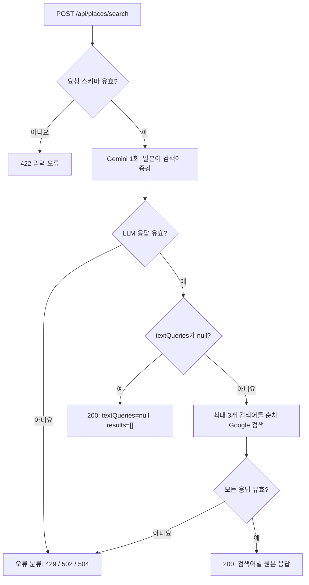

# 자연어 장소 검색 API

`POST /api/places/search`는 사용자 문장을 Gemini로 일본어 검색어로 증강·정규화한 뒤 Google Places Text Search (New)로 장소를 조회한다. LLM은 장소를 직접 추천하거나 추가 질문을 생성하지 않고 검색어 변환만 담당한다. 기존 FastAPI 앱에서 동선 최적화·주변 관광지 추천 API와 함께 사용할 수 있다.

## HTTP 계약과 구현 위치

| 항목 | 값 |
| --- | --- |
| Method | `POST` |
| Endpoint | `/api/places/search` |
| Request Content-Type | `application/json` |
| Response Content-Type | `application/json` |
| Request model | `PlaceSearchRequest` |
| Response model | `PlaceSearchResponse` |
| 정상 상태 | `200`: 검색 수행 또는 검색어 생성 불가 |
| 오류 상태 | `422`, `429`, `502`, `504` |

본문의 JSON 필드명은 대소문자를 구분한다. 이 문서는 현재 코드의 계약을 설명하며, 서버의 `/openapi.json`에서 Pydantic 기반 스키마를 확인할 수 있다. `clarificationQuestion`은 입력·출력 필드가 아니다.

| 책임 | 코드 |
| --- | --- |
| HTTP 처리·오류 상태 코드 | [api/places.py](../app/api/places.py) |
| 입력·출력·위치·LLM 모델 | [schemas/place_search.py](../app/schemas/place_search.py) |
| 키 확인·검색 흐름 | [services/place_search_service.py](../app/services/place_search_service.py) |
| 검색어 증강 규칙 | [prompts/place_search.py](../app/prompts/place_search.py) |
| Google 요청·FieldMask·응답 검증·외부 오류 분류 | [clients/google_maps.py](../app/clients/google_maps.py) |
| Gemini 요청·응답 파싱·연결 관리 | [llm/llm_wrapper.py](../app/llm/llm_wrapper.py) |
| 외부 서비스의 공통 오류 타입·상태 분류 | [errors.py](../app/errors.py) |
| 앱 등록·환경 변수 로딩 | [main.py](../app/main.py) |

## 실행과 호출

Google Cloud 프로젝트에서 결제를 연결하고 **Places API (New)**를 활성화한다. 저장소 루트 `.env`에 서버용 키를 설정한다.

```dotenv
GOOGLE_PLACE_API_KEY=발급받은_Google_Places_API_키
GEMINI_API_KEY=발급받은_Gemini_API_키
GEMINI_MODEL=gemini-3.5-flash-lite
```

장소 검색 모델은 공통 기본 모델인 `GEMINI_MODEL`로 지정한다. 앱의 `lifespan`에서 `GOOGLE_PLACE_API_KEY`, `GEMINI_API_KEY`, `GEMINI_MODEL`을 검증하며, 하나라도 미설정·빈 문자열·공백뿐이면 앱 시작이 실패한다. 실제 외부 API를 호출해 키나 모델의 유효성을 확인하지는 않는다. 모델의 앞뒤 공백은 제거하며 코드에 고정된 모델명으로 대체하지 않는다. 위 모델명은 설정 예시다. 주변 추천용 `GEMINI_NEARBY_MODEL`은 선택 사항이며 이 API에는 영향을 주지 않는다. 앱은 시작 시 루트 `.env`를 읽으며 기존 환경 변수는 덮어쓰지 않는다. API 키는 서버에서 관리하고 요청 JSON에는 넣지 않는다.

```bash
cd backend
poetry run uvicorn app.main:app --host 0.0.0.0 --port 8000
```

장소 검색에는 브라우저가 필요 없다. 동선 최적화까지 실행하려면 [백엔드 실행 안내](../README.md)의 Xvfb 실행 명령을 사용한다.

`http://localhost:8000/docs`에서 `POST /api/places/search`를 펼쳐 **Try it out**으로 요청할 수 있다. Codespaces에서는 전달된 8000번 포트 주소 뒤에 `/docs`를 붙인다.

```bash
curl -sS -X POST http://localhost:8000/api/places/search \
  -H 'Content-Type: application/json' \
  --data-binary '{"userQuery":"후지사와역 근처 인기 있는 야키니쿠집 찾아줘"}'
```

## 요청

### `PlaceSearchRequest`

`필수`는 JSON 키를 생략할 수 없는지, `nullable`은 명시적인 `null`을 허용하는지를 뜻한다. 기본값은 키를 생략했을 때만 적용된다.

| 필드 | JSON 타입 | 필수 | nullable | 기본값 | 검증·의미 |
| --- | --- | --- | --- | --- | --- |
| `userQuery` | string | 예 | 아니요 | 없음 | 최소 길이 1, 공백이 아닌 문자 필요. 앞뒤 공백 제거. 최대 길이 제한은 코드에 없음 |
| `pageSize` | integer | 아니요 | 아니요 | `20` | 검색어별 첫 페이지의 최대 장소 수. `1~20`. 엄격한 정수로 `true`, `1.5`, `"5"` 거부 |
| `rankPreference` | string | 아니요 | 아니요 | `"RELEVANCE"` | `"RELEVANCE"` 또는 `"DISTANCE"`만 허용 |
| `locationBias` | object | 아니요 | 예 | `null` | `LocationBias`. 특정 원·사각형 주변을 우선 검색하는 조건이며 영역 밖 결과도 가능 |

요청과 모든 중첩 위치 모델은 `extra="forbid"`이므로 표에 없는 키는 `422`다. `languageCode`, `regionCode`는 HTTP 입력에서 제거되었다. `"ko"`, `"JP"`처럼 서버 고정값과 같은 값을 보내도 거부한다. `openNow`, `pageToken`, `fieldMask`, API 키도 입력할 수 없다.

최소 요청:

```json
{"userQuery": "후지사와역 근처 인기 있는 야키니쿠집 찾아줘"}
```

Google 호출의 `languageCode="ko"`, `regionCode="JP"`는 서버 고정값이다. 일본어 검색어와 한국어 응답 언어는 함께 사용한다. 반환 언어에 관한 Google 설명은 [languageCode](https://developers.google.com/maps/documentation/places/web-service/text-search#languagecode)를 참고한다.

`regionCode="JP"`는 일본 내 결과만으로 엄격히 제한하는 조건이 아니다. 일본 장소 검색 유도는 검색어 증강 프롬프트가 담당한다. [Google regionCode 설명](https://developers.google.com/maps/documentation/places/web-service/text-search#regioncode)

원의 위치 우선 조건을 포함한 요청:

```json
{
  "userQuery": "후지사와역 근처 인기 있는 야키니쿠집 찾아줘",
  "pageSize": 20,
  "rankPreference": "RELEVANCE",
  "locationBias": {
    "circle": {
      "center": {"latitude": 35.3389, "longitude": 139.4876},
      "radius": 1000.0
    }
  }
}
```

### 중첩 위치 스키마

`LocationBias` 자체는 생략·`null` 모두 가능하다. 객체로 보내면 `circle`, `rectangle` 중 **정확히 하나의 값이 non-null**이어야 한다. `{}`, 두 값 모두 `null`, 두 객체를 동시에 지정하는 요청은 `422`다. 선택하지 않은 필드는 생략하거나 `null`을 보낼 수 있다.

| 모델·필드 | JSON 타입 | 필수 | nullable | 기본값 | 검증 |
| --- | --- | --- | --- | --- | --- |
| `LocationBias.circle` | object (`CircleBias`) | 아니요 | 예 | `null` | `rectangle`과 함께 정확히 하나 선택 |
| `LocationBias.rectangle` | object (`RectangleBias`) | 아니요 | 예 | `null` | `circle`과 함께 정확히 하나 선택 |
| `CircleBias.center` | object (`PlaceCoordinate`) | 예 | 아니요 | 없음 | 중심 좌표 |
| `CircleBias.radius` | number | 예 | 아니요 | 없음 | 미터 단위, `0~50000`, NaN·무한대 불가 |
| `RectangleBias.low` | object (`PlaceCoordinate`) | 예 | 아니요 | 없음 | 남서쪽 좌표 |
| `RectangleBias.high` | object (`PlaceCoordinate`) | 예 | 아니요 | 없음 | 북동쪽 좌표 |
| `PlaceCoordinate.latitude` | number | 예 | 아니요 | 없음 | `-90~90`, NaN·무한대 불가 |
| `PlaceCoordinate.longitude` | number | 예 | 아니요 | 없음 | `-180~180`, NaN·무한대 불가 |

좌표·반경은 Pydantic의 float 변환을 사용하며 `pageSize`처럼 strict 정수가 아니다. 사각형은 `low.latitude > high.latitude`이면 거부한다. 경도는 `low.longitude=180`, `high.longitude=-180`인 빈 범위를 거부하며, 그 외에 `low.longitude <= high.longitude` 조건을 강제하지 않는다.

사각형을 사용하는 요청 예시:

```json
{
  "userQuery": "후지사와 카페",
  "locationBias": {
    "rectangle": {
      "low": {"latitude": 35.30, "longitude": 139.45},
      "high": {"latitude": 35.40, "longitude": 139.55}
    }
  }
}
```

`openNow`는 서버에서 항상 `false`로 전송한다. 반환 필드도 서버의 `FIELD_MASK`로 고정한다. 이 API는 첫 페이지만 검색하므로 `pageToken`을 받지 않는다. 재작성된 검색어마다 페이지 토큰이 다르므로 한 토큰을 여러 검색어에 공통 적용할 수 없다.

## 정상 응답

### `PlaceSearchResponse`와 `PlaceSearchResult`

HTTP `200`에서는 `userQuery`, `textQueries`, `results`를 항상 반환한다. 모델의 필수 여부와 런타임 응답에 키가 포함되는지는 구분한다. `results`는 모델 기본값이 `[]`이므로 OpenAPI에서는 필수 키가 아니지만 서비스 응답에는 항상 포함된다.

| 필드 | JSON 타입 | 모델 필수 | nullable | 기본값 | 의미 |
| --- | --- | --- | --- | --- | --- |
| `userQuery` | string | 예 | 아니요 | 없음 | 앞뒤 공백을 제거한 입력 문장 |
| `textQueries` | array of string | 예 | 예 | 없음 | 일본어 검색어 `1~3`개 또는 `null`. 검색어 생성 불가는 `[]` 대신 `null` |
| `results` | array of `PlaceSearchResult` | 아니요 | 아니요 | `[]` | 최대 3개. `textQueries` 순서와 동일한 검색어별 첫 페이지 |
| `results[].textQuery` | string | 예 | 아니요 | 없음 | 해당 Google 요청의 검색어. 최소 길이 1, 공백 이외 문자 필요 |
| `results[].response` | object | 예 | 아니요 | 없음 | 검증을 통과한 Google 원본 JSON. 서버가 장소 모델로 재구성하지 않음 |

`textQueries`의 키 생략과 `"textQueries": null`은 서로 다르다. 정상 응답에는 `clarificationQuestion`이 없다. 응답 모델·개별 결과 모델도 정의되지 않은 필드를 거부하지만, 원본을 보존하는 `response` 객체 내부에는 추가 필드가 존재할 수 있다.

### 검색 수행: HTTP `200`

아래 검색어와 장소는 구조 설명용 예시다.

```json
{
  "userQuery": "후지사와역 근처 인기 있는 야키니쿠집 찾아줘",
  "textQueries": ["藤沢駅 焼肉 人気店"],
  "results": [
    {
      "textQuery": "藤沢駅 焼肉 人気店",
      "response": {
        "places": [
          {
            "id": "example-place-id",
            "displayName": {"text": "예시 야키니쿠점", "languageCode": "ko"},
            "formattedAddress": "일본 가나가와현 후지사와시 예시 주소",
            "location": {"latitude": 35.3389, "longitude": 139.4876},
            "primaryType": "restaurant",
            "types": ["restaurant", "food"],
            "googleMapsUri": "https://maps.google.com/?cid=EXAMPLE"
          }
        ],
        "nextPageToken": "example-next-page-token"
      }
    }
  ]
}
```

### 검색어 생성 불가: HTTP `200`

검색 의도가 모호해 유용한 검색어를 만들 수 없으면 Gemini는 `{"textQueries": null}`을 반환한다. API는 입력 문장을 보존하고 다음처럼 HTTP `200`으로 응답한다. 이때 Google Places 호출은 0회이며 추가 질문은 반환하지 않는다.

```json
{
  "userQuery": "거기 그거 찾아줘",
  "textQueries": null,
  "results": []
}
```

지역이 넓거나 검색 결과가 확실하지 않다는 이유만으로 `null`을 반환하지는 않는다. 유용한 검색어를 만들 수 있으면 일본어 검색어 `1~3`개로 검색을 진행한다.

### 검색 수행 후 장소 0건: HTTP `200`

검색어는 만들었으나 Google에 장소가 없는 경우는 `textQueries=null`과 구분한다. 다음처럼 검색어와 해당 응답 객체를 유지한다. `response`가 `{}`이거나 `{"places": []}`인 경우 모두 정상이다.

```json
{
  "userQuery": "후지사와 카페",
  "textQueries": ["藤沢 カフェ"],
  "results": [{"textQuery": "藤沢 カフェ", "response": {}}]
}
```

### Google 원본의 선택 필드

다음은 서버가 FieldMask로 **요청하는** 필드이며 모든 응답에 존재하는 필수 필드 목록이 아니다. 장소 데이터가 없으면 `places`가 생략될 수 있고, 개별 장소의 데이터도 누락될 수 있다. 아래 타입은 Google 응답을 읽을 때의 참고이며 `dict[str, Any]` 내부의 개별 필드를 서버가 Pydantic 모델로 강제하지 않는다.

| `results[].response` 내부 경로 | 일반적인 JSON 타입 | 누락 가능 | 의미 |
| --- | --- | --- | --- |
| `places` | array of object | 예 | 장소 목록. 누락 시 `[]`로 취급 |
| `places[].id` | string | 예 | Google 장소 ID |
| `places[].displayName` | object | 예 | 표시 이름 객체 |
| `places[].displayName.text` | string | 예 | 화면에 표시할 이름 |
| `places[].displayName.languageCode` | string | 예 | 표시 이름의 언어 |
| `places[].formattedAddress` | string | 예 | 표시용 주소 |
| `places[].location` | object | 예 | 좌표 객체 |
| `places[].location.latitude` | number | 예 | 위도 |
| `places[].location.longitude` | number | 예 | 경도 |
| `places[].primaryType` | string | 예 | 대표 장소 유형 |
| `places[].types` | array of string | 예 | 장소 유형 목록 |
| `places[].googleMapsUri` | string | 예 | Google 지도 링크 |
| `nextPageToken` | string | 예 | 검색어별 다음 페이지 토큰. API는 보존만 하며 추가 조회하지 않음 |

`response`는 dict여야 하며 `error` 키를 포함하면 실패한다. `places`가 있으면 dict의 목록이어야 하고, `nextPageToken`이 있으면 문자열이어야 한다. 이 검사 외에는 원본 필드를 그대로 보존한다. 장소 내부에 모든 필드가 없더라도 dict이면 이 검증을 통과한다.

현재 FieldMask는 다음과 같다. `name`, 평점, 리뷰 수, 영업시간은 요청하지 않는다.

```text
places.id,places.displayName,places.formattedAddress,places.location,
places.primaryType,places.types,places.googleMapsUri,nextPageToken
```

반환 필드를 바꾸려면 [search_text()의 FIELD_MASK](../app/clients/google_maps.py)를 수정한다. 공용 클라이언트를 변경하면 호출하는 다른 코드의 영향도 함께 확인해야 한다.

## 코드 구조와 처리 흐름

```text
app/
├── api/places.py                   # HTTP 요청·응답과 오류 상태 코드
├── schemas/place_search.py         # API 입력·출력, 위치 조건, LLM 결과 검증
├── services/place_search_service.py # Gemini 재작성 → 최대 3개 Places 검색
├── prompts/place_search.py         # textwrap.dedent로 정리한 영어 프롬프트
└── clients/google_maps.py          # Google Text Search 요청과 원본 JSON 반환
tests/
├── test_text_search.py             # 요청 모델을 만들어 실제 서비스를 호출하는 수동 실행
├── test_text_search_flow.py        # 재작성 결과·호출 횟수 제한 검증
└── test_places_api.py              # HTTP 입력·응답·오류 검증
```

요청은 다음 순서로 처리한다.

1. FastAPI가 `PlaceSearchRequest`를 검증한다. 실패하면 외부 호출 없이 `422`를 반환한다.
2. 동기 `def` 라우터가 작업 스레드에서 서비스를 실행한다. 필수 환경 변수는 앱 시작 시 검증했으므로 서비스는 요청마다 설정 누락을 다시 확인하지 않는다.
3. 요청마다 `GEMINI_MODEL`에 지정한 모델로 Gemini 클라이언트를 생성한다. `userQuery`만 `{"userQuery": "..."}` 형태로 LLM에 전달하며 `locationBias` 등 검색 옵션은 전달하지 않는다.
4. Gemini가 프롬프트와 `QueryRewrite` JSON Schema를 받아 일본어 검색어를 증강한다. 내부 출력은 `{"textQueries": ["일본어 검색어"]}` 또는 `{"textQueries": null}`이다. 기본 출력 토큰 수는 1024이며 이 흐름은 temperature를 별도 지정하지 않는다.
5. 서버는 LLM 결과의 추가 필드를 거부하고 검색어가 있으면 먼저 최대 3개로 자른 뒤 앞뒤 공백·중복을 제거한다. 빈 목록·빈 검색어·잘못된 응답은 `502`다. 일본어 여부·실제 장소 존재는 별도의 코드 검증을 하지 않는다.
6. `textQueries=null`이면 Google을 호출하지 않고 `results=[]`로 `200`을 반환한다.
7. 검색어가 있으면 순서대로 각 검색어의 Google Text Search 첫 페이지를 최대 3회 조회한다. Google에 `languageCode=ko`, `regionCode=JP`, `openNow=false`와 요청의 `pageSize`, `rankPreference`, 선택적 `locationBias`를 보낸다.
8. Google 클라이언트가 응답을 검증하고 서비스는 `results`에 원본을 넣는다. 중간 검색이 실패하면 전체 요청이 실패하며 앞서 받은 부분 결과를 반환하지 않는다.
9. `with` 블록을 나가며 Gemini 클라이언트를 닫는다. 래퍼는 정리 중 발생한 오류를 로그에 남기고 기존 결과·오류를 유지한다.



LLM 프롬프트는 장소 탐색 의도마다 1개씩 최대 3개를 생성하고 단일 의도는 1개만 만들도록 지시한다. 지역이 넓다는 이유만으로 `null`을 반환하지 않으며, 식별할 수 있는 장소 탐색 의도가 없거나 필수 맥락을 지어내야 할 때 `null`을 반환하도록 한다. 추가 질문·장소 추천·외부 리서치 단계는 이 흐름에 없다.

## 호출 수·동시성·제한

| 항목 | 현재 동작 |
| --- | --- |
| Gemini | 요청 검증 후 논리 호출 1회. 요청마다 클라이언트 생성·종료 |
| Google Places | 검색어 생성 불가 시 0회, 생성되면 1~3회 |
| Google 호출 순서 | 한 HTTP 요청 내에서는 순차 실행. 검색어 순서대로 `results` 반환 |
| 서로 다른 HTTP 요청 | FastAPI 작업 스레드에서 동시 처리 가능. 이 API 전용 lock·semaphore 없음 |
| 장소 수 | 검색어당 최대 `pageSize`개를 요청. 기본 설정에서 합계 최대 60개 요청, 고유 장소 수는 아님 |
| 중복 처리 | LLM 검색어는 중복 제거. 서로 다른 검색어의 장소는 병합·중복 제거하지 않음 |
| 페이지네이션 | 첫 페이지만 조회. `nextPageToken` 반환 가능, API 입력 `pageToken`은 미지원 |
| 재시도·캐시 | 애플리케이션의 자동 재시도·추가 LLM 시도·검색 캐시 없음 |
| 요청 한도 | 자체 사용자별 rate limiter 없음. 공급자의 `429`를 HTTP `429`로 변환 |
| 외부 timeout | Gemini HTTP 옵션 `30000ms`, Google `requests.post(timeout=30)` |
| 전체 timeout | 별도의 요청 전체 deadline 없음. 외부 호출별 timeout을 합친 값이 엄격한 전체 시간 상한은 아님 |

장소 수 제한은 Google에 요청하는 `pageSize` 기준이며 서버가 응답 장소 목록을 다시 잘라서 보정하지 않는다.

## 프론트엔드·동선 API 연결

이 API는 Google 원본 필드명을 반환한다. 선택한 장소를 동선 API의 [PlaceInput](../app/schemas/route.py)으로 전달할 때 다음처럼 변환한다. 이 변환을 장소 검색 서버가 수행하지는 않는다.

| 검색 결과의 원본 경로 | 동선 API 입력 경로 |
| --- | --- |
| `results[].response.places[].id` | `days[].places[].googlePlaceId` |
| `results[].response.places[].displayName.text` | `days[].places[].name` |
| `results[].response.places[].location.latitude` | `days[].places[].location.lat` |
| `results[].response.places[].location.longitude` | `days[].places[].location.lng` |

`displayName.text`가 표시 이름이다. Google의 `name` 리소스 필드는 현재 요청하지 않으며 동선 API의 `name`과 혼동하지 않는다. 원본 필드는 누락될 수 있으므로 장소를 동선 입력으로 만들기 전에 ID·이름·좌표를 확인한다. `textQueries=null`이면 빈 상태를 표시하고 Google 결과를 펼치지 않는다. `places` 누락은 빈 배열로 읽는다. 여러 검색어의 동일 ID를 하나로 표시하려면 소비자가 중복을 처리한다.

## 실행·검증 참고

프롬프트, 요청 검증, 검색 흐름, 외부 호출을 각 모듈에서 수정할 수 있다. 앱은 테스트 모듈을 가져오지 않으며 수동 테스트가 운영 서비스를 호출한다.

서버를 켜지 않고 실제 검색 흐름을 확인하려면 `tests/test_text_search.py`의 요청값을 수정하고 실행한다. 결과는 터미널과 `tests/text_search_results.json`에 저장하며, 이 실행도 외부 API를 사용한다.

```bash
cd backend
poetry run python -m tests.test_text_search
```

외부 API를 호출하지 않는 검증은 다음처럼 실행한다.

```bash
poetry run python -m unittest tests.test_text_search_flow tests.test_places_api
```

Google만 직접 호출하거나 수동으로 다음 페이지를 조회할 때는 내부 클라이언트의 `search_text()`를 사용한다. 같은 `text_query`와 검색 조건을 유지하고 해당 응답의 `nextPageToken`을 `page_token`으로 전달한다. 자연어 검색 API는 페이지 토큰을 재사용하지 않는다.

## 오류 응답

| HTTP 상태 | 실제 분류 조건 | `detail` |
| --- | --- | --- |
| `422` | FastAPI/Pydantic 요청 검증 실패. 빈 검색 문장, 결과 수·정렬·위치 오류, 정의되지 않은 입력 키 등 | Pydantic 오류 목록 |
| `429` | Gemini `APIError.code=429` 또는 Google HTTP `429` | `외부 검색 서비스의 요청 한도를 초과했습니다. 잠시 후 다시 시도해주세요.` |
| `502` | 기타 Gemini API 오류·Google HTTP 오류, requests/httpx 연결 오류, LLM 차단·빈 응답·미완료·스키마 오류, Google 응답 구조 오류 | `외부 검색 서비스에서 정상적인 응답을 받지 못했습니다.` |
| `504` | requests/httpx timeout 또는 Gemini/Google 상태 `408`, `504` | `외부 검색 서비스 응답 시간이 초과되었습니다.` |

입력 검증 오류는 `{"detail": [...]}`, 서비스 오류는 `{"detail": "설명"}` 형식이다. 서비스 오류에는 외부 응답 본문·키 등 내부 정보를 노출하지 않는다.

LLM 래퍼·Google 클라이언트가 외부 호출·응답 오류를 공통 `Provider*` 예외로 분류하고 API가 위 표의 HTTP 상태로 변환한다. 내부 코드의 일반 `TypeError`·`AttributeError` 등을 외부 서비스 오류로 묶지 않는다. 공급자의 모든 `5xx`를 `503`으로 전달하는 정책은 없으며, 예를 들어 Google HTTP `500`은 `502`다. `textQueries=null`과 Google의 정상 0건 응답은 오류가 아니다.

공식 문서: [Text Search 가이드](https://developers.google.com/maps/documentation/places/web-service/text-search?hl=ko), [요청·응답 REST 스펙](https://developers.google.com/maps/documentation/places/web-service/reference/rest/v1/places/searchText), [Place 응답 필드](https://developers.google.com/maps/documentation/places/web-service/reference/rest/v1/places).
