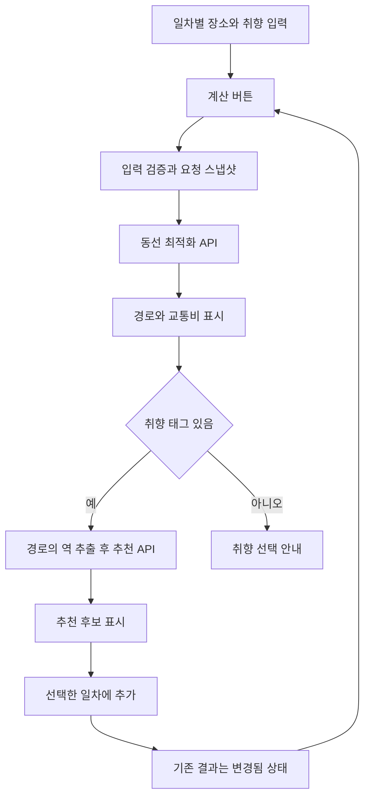

> 과거 기획·조사 기록입니다. 미구현 제안과 당시 판단을 포함하며 현재 API 계약이나 구현 완료를 뜻하지 않습니다. 현재 동작은 [프론트 README](../../../web/README.md), API 계약은 그 문서의 Notion 원문 링크를 확인하세요. 원래 작업 문서의 내용은 보존하되 저장소 경로와 비공개 로컬 파일 참조를 정리했습니다.

# 프론트 데모 계획

작성 기준: 2026-10-25. 상태: 논의용 제안. 제품 코드와 Notion 문서는 변경하지 않았다.

## 1. 제품 방향과 근거

**큰 지도와 하나의 우측 패널에서 일차별 장소 입력, 최적화 결과 확인, 주변 추천 선택을 이어가는 PC 중심 플래너**를 만든다. 사용자는 꼭 가고 싶은 곳을 날짜별로 정하고, 서비스는 방문 순서와 교통비, 경로 주변의 추가 후보를 보여준다.

- [26.10.11](https://app.notion.com/p/3f86b39941c28064a148c26d8d690c4f): 일본 여행 초보자, 몇 곳의 필수 관광지와 남는 시간에 대한 제안이 주요 사용 맥락이다.
- [26.10.18](https://app.notion.com/p/3fd6b39941c280edb2b2cd14e4a77818): 사용자가 일차별 관광지를 정하고 그 안에서 순서를 최적화한다. 데모는 지도, 관광지·역 핀, 교통비, 일차별 장소 입력, 취향 입력에 집중한다.
- [API 스키마 확정](https://app.notion.com/p/3fd6b39941c2803f97bbe4d893075738): 현재 화면이 실제로 소비할 수 있는 입력·출력의 기준이다. 아래 명세 불일치는 별도 합의가 필요하다.
- [프로젝트를 시작하기 전에…](https://app.notion.com/p/3ec6b39941c280de9b92eece8d4566ea): 초기 디자인과 PC 우선 방향을 참고하되, 과거 패스·시간표 기획 전체를 이번 데모의 구현 범위로 해석하지 않는다.

프로젝트 루트, 사전 기획, 회의록 2개, 실제 작업 페이지 11개와 작업 템플릿, 최신 API 문서 및 관련 댓글을 확인했다. 추천 구현 페이지의 별칭 블록 1개는 도구에서 지원하지 않아 읽지 못했다. 모든 첨부 이미지 원본을 확인한 것은 아니며, 로컬 입력·결과 화면 이미지 2개와 프론트 주요 코드는 직접 확인했다.

## 2. 현재 구현과 이번 변경 범위

현재 `web`은 Vite와 vanilla TypeScript 기반이다. Google 지도, 일본 장소 자동완성·선택, 시간표 입력이 있다. 지도에는 선택 장소 한 곳만 표시하며, 제출은 입력 요약을 만든다. 브라우저에서 백엔드 동선·추천 API를 호출하는 기능은 아직 없다. 별도 CLI 최적화 실험을 브라우저 연동 완료로 간주하지 않는다.

기존 지도 로더, 검색의 IME 처리·디바운스·오래된 응답 방지, 스타일을 재사용한다. 프레임워크 전환은 필요하지 않다. 기존 시간표 코드는 보존하되, 데모 입력은 일차별 목록 모델로 분리한다. 기존 고정시각·체류시간 조건을 몰래 버리고 제출하는 방식으로 연결하지 않는다.

| 이번 데모 | 후속 확장 |
| --- | --- |
| 시작일·여행 일수, 일차별 출발 시각 | 숙소·출발지·도착지 앵커 |
| 일차별 방문 장소 검색·선택, 하루 1~8곳 | 자동 일차 배분 |
| 백엔드 최적 방문 순서·구간 교통비·이동 시간 | 최적화 기준 선택·대체 순서 비교 |
| 관광지·역 핀, 이동 순서 연결선 | 실제 선로·도보 경로 형상 |
| 경로상 역 주변 취향 추천, 선택 후 재계산 | 우회 허용 추천, 우회 시간·비용 |
| 태그 6종과 선택적 요청 문장 | 체류시간·고정 방문시각·영업시간 반영 |
| 일차별·전체 교통비 합계 | 패스 비교·절약액·RAG |

## 3. 화면 구성

```text
┌─────────────────────────────────────────────────────────────┐
│ 여행 시작일 · 여행 일수             입력 / 결과             │
├──────────────────────────────────────┬──────────────────────┤
│                                      │ 1일차 / 2일차 / …    │
│                                      │                      │
│             Google 지도              │ 입력: 장소 검색·목록 │
│                                      │       취향 선택      │
│   관광지 번호 / 역 / 추천 장소 핀     │                      │
│   선택 일차의 이동 순서 연결선        │ 결과: 이동 일정      │
│                                      │       주변 추천      │
│                                      │                      │
│                                      │ 실행 / 다시 계산     │
└──────────────────────────────────────┴──────────────────────┘
```

지도 약 65~70%, 우측 패널 약 360~440px를 출발점으로 삼고 실제 화면 폭에 맞춘다. 1366×768 및 1920×1080에서 페이지 전체의 가로 스크롤이 생기지 않아야 한다. 날짜가 많으면 이전·다음 날짜 묶음으로 전환하고, 패널 내용은 세로로 스크롤한다. 좁은 화면에서는 패널을 지도 아래에 배치한다. 정교한 모바일 화면은 후속 범위다.

입력과 결과를 전환해도 지도를 재생성하지 않는다. 선택 일차를 지도·목록·추천이 공유한다. 카드 또는 핀을 명시적으로 선택하면 서로 강조하고, 화면 상태가 바뀔 때마다 지도를 자동 확대하거나 이동시키지 않는다.

### 입력 패널

1. 여행 시작일과 여행 일수. 종료일은 계산해 함께 보여줄 수 있다.
2. 선택 일차의 출발 시각: 기본 08:00, 일본 현지 시각으로 표시한다.
3. 장소 검색 결과에서 선택해 해당 일차에 추가한다. 자유 입력 문장은 확정 장소로 취급하지 않는다.
4. 장소별 이름, 일차 이동, 삭제와 `현재 개수 / 8`을 보여준다. 장소 주소는 검색 결과에 있으면 구분용으로 표시할 수 있으나 API 필수 입력으로 만들지 않는다.
5. 취향 태그와 선택적 요청 문장을 받는다.
6. 실행 전 각 일차에 1~8곳이 있는지 확인한다. 편집 도중 빈 날은 허용한다. 여행 일수를 줄일 때 기존 장소가 조용히 삭제되지 않도록 보관·복구 흐름을 제공한다.

태그는 현재 명세의 `culture` 역사·문화, `nature` 자연·풍경, `anime` 애니메이션, `shopping` 쇼핑, `relaxation` 휴식·힐링, `activity` 액티비티로 맞춘다. 이전 대화의 ‘인스타·맛집’은 현재 enum에 없으므로 임의 매핑하지 않는다. 태그가 없으면 동선 계산은 가능하게 하고, 추천에는 취향 선택 안내를 보여준다.

### 이동 결과 패널과 지도

- 선택 일차의 방문 순서, 총 이동 시간, 교통비를 먼저 보여준다. 전체 여행 합계도 확인할 수 있게 한다.
- 관광지 사이 구간 카드에 출발·도착 역, 교통편, 소요 시간, 구간 전체 요금을 보여준다. 환승 상세는 접어서 표시한다.
- 관광지는 방문 순서 번호, 역은 별도 모양, 추천 장소는 또 다른 모양으로 구분한다. 색상만으로 구분하지 않는다.
- 현재 응답에는 실제 경로 형상인 geometry/polyline이 없다. 역 좌표 사이를 잇는 선은 ‘이동 순서 연결선’으로 표시한다. 실제 철도 선형이나 관광지 접근 도보 경로로 설명하지 않는다.
- `timingBasis: stationTravelOnly`에 맞춰 ‘역 간 이동 기준 · 관광지 접근 도보와 체류시간 제외’를 표시한다. 누적 이동 시각을 완성된 관광 일정의 실제 도착 시각처럼 표현하지 않는다.
- 같은 역을 사용하는 두 관광지도 별도 방문으로 유지한다. API의 0분·0엔은 해당 역 간 비용 모델이며 관광지 간 실제 도보가 없다는 뜻은 아니다.

### 주변 추천 패널

- 해당 일차의 경로에 등장한 역을 기준으로 후보를 보여준다. 역·환승 맥락을 함께 표시한다.
- 이름, 제공된 태그·분류, 확인된 기준의 거리만 사용한다. 응답에 없는 추천 이유·사진·평점·추가 시간·추가 요금을 생성하지 않는다.
- `distanceMeters`의 산출 기준이 확인되기 전에는 도보거리 또는 도보시간으로 표시하지 않는다.
- 동일 Google Place ID의 추천 카드는 합치되 관련 역·일차 연결은 보존한다. 이미 일정에 있는 장소는 상태를 표시한다.
- ‘이날 일정에 추가’로 편집 목록에 넣고 결과를 ‘변경됨’으로 표시한다. 자동으로 동선을 바꾸지 않는다. 하루 8곳 제한을 확인하고 사용자가 ‘다시 계산’을 누르면 새 경로를 구한다.
- 여러 일차가 같은 역을 지나는 경우 추가할 일차를 명시적으로 선택한다.

## 4. 요청 흐름과 상태 관리



이것은 한 번의 사용자 실행에서 두 API를 순차 호출하는 제안이다. 통합 엔드포인트가 이미 있다는 뜻은 아니다. 동선은 `POST /api/routes/optimize`가 문서에 있지만, 추천 URL은 확인한 자료에 없어 합의해야 한다. 근거: [동선 최적화 API](https://app.notion.com/p/3fd6b39941c2807aa445d3690556bd37), [경로 기반 개인화 컨텐츠 추천 API](https://app.notion.com/p/3fd6b39941c280a29de2fceda9929c33).

- 편집 중인 입력, 마지막 유효 경로, 추천 결과, 현재 선택 일차·장소, 각 요청 상태를 분리한다.
- 추천 응답은 백엔드와 합의한 단일 최상위 형태만 파싱한다. 형태 불일치는 계약 오류로 처리하고, 단일 객체와 배열 래퍼를 자동으로 오가며 수용하지 않는다.
- 요청 당시 입력 스냅샷과 입력 버전을 저장한다. 이후 입력이 바뀌거나 새 요청이 시작되면 이전 응답을 최신 결과에 적용하지 않는다.
- `visitId`는 원래 요청의 일차·입력 인덱스에 대응한다. 화면 내부에는 별도 안정 ID를 두고 요청별 매핑으로 연결한다. 재계산 사이에서 같은 영구 ID로 취급하지 않는다.
- 방문역과 환승역의 원본 일차·구간 참조를 유지한다. 역 이름만으로 합치지 않는다. 안정적인 역 ID가 없는 동안에는 이름·정확한 좌표가 일치하는 항목의 임시 연결만 사용하며, 모호하면 병합을 보류한다.
- 추천 실패 시 이미 성공한 동선 결과를 유지하고 추천만 재시도한다. 비용과 시간이 큰 동선 계산을 자동으로 반복하지 않는다.
- 취향만 바뀐 경우 유효한 경로를 유지한 채 추천만 다시 실행할 수 있다. 장소·일차·출발 시각 변경과 구분한다.
- 일차 전환, 카드 선택, 지도 강조, 목록 편집 자체로 백엔드 또는 Places 상세 조회를 반복하지 않는다.
- 계산 중, 결과 없음, 입력 변경됨, 추천 없음, 추천만 실패, 동선 실패를 구분한다. 서버 오류·누락 요금을 0으로 표시하지 않는다.

## 5. 백엔드와 우선 맞출 계약

| 항목 | 현재 문서 | 합의할 내용 |
| --- | --- | --- |
| Google Place ID | 공통 설명은 선택, JSON Schema는 필수 비어 있지 않은 문자열. 출력의 null 허용도 설명과 스키마가 다름 | 실제 서버 검증 모델/OpenAPI 기준으로 필수·누락·null 처리 통일. 가짜 ID를 넣지 않음 |
| 추천 응답 최상위 | Schema는 단일 역 객체, 예제는 `results[]` | 여러 역 요청에 대한 최상위 배열 구조, 역별 대응 규칙 |
| 역 식별 | 추천에는 nullable `stationId`, 동선의 Station에는 없음 | 두 API가 공유하는 안정 역 ID 또는 명시적인 요청·응답 대응 키 |
| 추천 개수·거리 | `placeCount` 1~20, `radius` 최대 50,000m, `distanceMeters` 반환 | 개수가 역별인지 전체인지, 거리 계산 기준. UI 초깃값은 역별 3개·반경 1,000m를 제안하되 계약 확정 후 적용 |
| 운영 연결 | 동선 URL만 확인, 오류·부분 성공·대기 정책 불충분 | 추천 URL, 개발 base URL, CORS, 오류 형태, 시간 제한과 취소·부분 실패 처리 |
| 1개 장소·동일 역 | 입력은 일차별 최소 1곳, 동일 역 구간은 0분·0엔 | 한 장소만 있는 날의 응답과 합계, 누락된 교통 데이터 처리 |

역 좌표는 최신 명세에서 필수로 정리돼 있다. 주소를 필수로 추가할 이유는 없다. 현재 한 가지 순서만 반환하므로 비용/시간 최적화 토글이나 복수 후보 선택 UI를 먼저 만들지 않는다. 위 계약 확인은 실제 연동의 선행 조건이며, 입력 화면과 fixture 기반 결과 화면 작업은 먼저 진행할 수 있다.

## 6. 개발 순서와 수용 기준

### 1차: 입력과 지도

현재 검색을 재사용해 일차별 목록 모델, 날짜·태그 입력, 복수 장소 핀을 만든다. 지도 인스턴스와 선택 상태를 유지한다. 기존 시간표 모델과 데모 모델의 경계를 분리한다.

완료 기준: 일차를 바꿔도 입력이 유지되고, 장소 이동·삭제·기간 축소 시 손실이 없으며, 하루 8곳 초과와 미확정 장소가 제출되지 않는다. 기준 PC 화면에서 가로 스크롤이 없다.

### 2차: 동선 결과

합의된 요청·응답 fixture로 직렬화·역직렬화와 상태 전환을 만든 뒤 실제 클라이언트를 연결한다. 화면 내부 상태와 서버 DTO, 즉 API 송수신용 데이터 구조를 분리한다.

완료 기준: 입력 장소가 최적화 순서로 정확히 대응되고, n개 방문의 n−1개 구간 및 합계가 맞는다. 한 장소만 있는 날은 방문 1개·구간 0개이며 이동 시간·교통비 합계를 검증한다. 동일 역의 관광지 두 곳이 사라지지 않는다. 잘못된 응답은 정상 결과처럼 보정하지 않는다. 오래된 응답이 새 입력을 덮어쓰지 않는다.

### 3차: 추천과 재계산

성공한 동선에서 역을 추출해 추천을 요청하고, 역·일차 연결, 중복 표시, 선택 추가와 다시 계산을 연결한다.

완료 기준: 추천 실패가 동선을 지우지 않고, 추천만 재시도할 수 있다. 이미 포함된 장소와 8곳 제한을 처리한다. 여러 일차와 연결된 추천이 임의의 첫날에 들어가지 않는다. 취향 변경만으로 동선 크롤링을 다시 실행하지 않는다.

### 4차: 시연 흐름 점검

입력 → 계산 → 지도·목록 확인 → 추천 추가 → 재계산을 한 번에 시연한다. 로딩 중 중복 실행, 느린 응답·오류·빈 추천, 키보드 조작, 긴 장소명·긴 날짜 목록을 확인한다. 먼저 fixture로 확인하고 실환경 검증은 현재 API 제한과 실행 권한 범위에 맞춘다.

테스트는 기존 `npm test`의 Node.js 내장 테스트 러너를 재사용하고, ID 매핑, 응답 경합, 실패 격리, 1개 장소·8개 제한·기간 축소 보관처럼 실제 회귀 위험이 있는 부분에 집중한다. 추천 중복 병합·여러 일차 귀속은 순수 함수 테스트로, 역 간 이동 기준 안내 문구는 렌더 스모크 점검으로 확인한다. fixture에는 계약 출처·버전을 남기고, 오류 fixture는 백엔드 오류 계약이 확정되기 전까지 임시 계약으로 표시한다. 레이아웃은 기준 해상도에서 수동 점검한다. 이번 작업은 계획 문서만 작성하므로 제품 빌드·테스트를 실행해 구현이 검증됐다고 보고하지 않는다.

## 7. 모듈 경계 제안

구현 시 기존 파일을 살리면서 다음 책임만 분리한다. 파일명은 구현 단계에서 조정할 수 있다.

- 편집 모델: 일차별 장소와 내부 ID, 입력 검증, 변경 버전.
- API 경계: 동선·추천 DTO, 요청 매핑, 응답 검증, 오류 분류.
- 실행 제어: 요청 스냅샷, 순차 호출, 오래된 응답 방지, 추천 단독 재시도.
- 지도 제어: 관광지·역·추천 핀, 연결선, 선택·강조, 범위 조정.
- 입력·결과·추천 뷰: 공통 상태를 표시하고 사용자 의도를 실행 제어에 전달.

시간표와 CLI 최적화 실험은 독립적으로 보존한다. 프론트에서 방문 순서를 다시 최적화하거나 서버 결과의 빈 시간을 임의로 메우지 않는다.

## 8. 추가 근거와 검토 상태

- [사용자 취향 및 경로 기반 주변 컨텐츠 추천](https://app.notion.com/p/3fd6b39941c280138d7af8783639e635): 태그 6종과 구현 처리 근거.
- [경로 최적화](https://app.notion.com/p/3f76b39941c280709b39fbf09d433548): 역 간 비용 모델과 주소 관련 논의.
- [장소에서 가장 근처에 있는 역 이름 가져오기](https://app.notion.com/p/3f76b39941c280e4a81ef92666664266): 장소에서 역으로 연결하는 백엔드 처리 근거.
- [Google Place Autocomplete Data API](https://developers.google.com/maps/documentation/javascript/place-autocomplete-data): 기존 자동완성 후 선택한 장소의 상세 정보를 가져오는 구조를 재사용할 수 있는 근거.
- [Google Maps Shapes and lines](https://developers.google.com/maps/documentation/javascript/shapes): 좌표로 선을 그리는 기능의 근거. 역 좌표만으로 실제 철도 경로를 복원할 수 없다는 판단은 현재 응답 필드와 이 기능의 결합에 대한 추론이다.

Notion의 작업 완료 표시와 curl 통과 보고는 팀 기록이며, 현재 배포된 백엔드에 직접 접속해 검증한 결과는 아니다.

Opus 설계 검토를 완료했다. 기존 기술 스택 재사용, 일차별 목록, 지도 유지, 요청 스냅샷, 추천 실패 격리와 명시적 재계산 권고를 반영했다. 미합의 응답 형태 두 가지를 항상 허용하거나, 역 좌표를 근사 비교해 병합하자는 제안은 채택하지 않았다. API 형태는 서버와 합의하고, 역 식별이 모호한 경우에는 병합을 보류하는 편이 계약 오류와 추천 오귀속을 줄인다. 검토가 제안한 추가 승인 절차는 이번 계획의 요건으로 넣지 않았다. 실제 외부 호출은 당시 사용자 지시와 기존 비용 제한을 따른다.

이 문서가 통합된 최종 설계 계약이며 Opus의 초기 제안과 다를 때 이 문서의 인터페이스·불변조건·수용 기준을 적용한다. Opus 독립 재검증 결과는 PASS이며, 지적된 테스트 계획 보완 사항도 반영했다. 이는 계획의 정합성 검증이며 구현 완료 또는 실 API 검증을 뜻하지 않는다.
